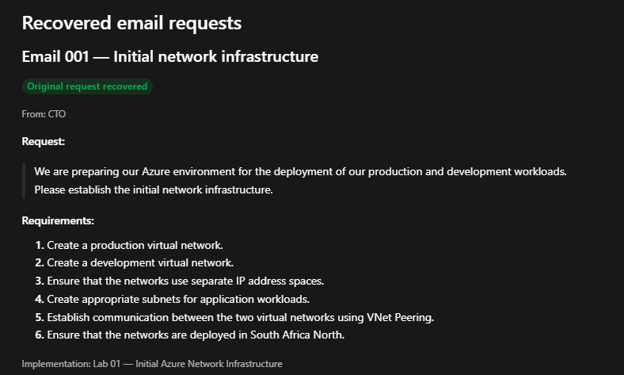

# Email 001 — CTO Initial Network Infrastructure

**Project:** [AZ-PRJ-001 — Azure Environment Foundation](../README.md)  
**Request Reference:** Email 001  
**Request Owner:** CTO  
**Status:** Request Details Recovered — Date and Acceptance Evidence Pending  
**Related Milestone:** [AZ-001 — Network Infrastructure](../02-Implementation/AZ-001-Network-Infrastructure.md)

---

## 1. Source Evidence

The supplied screenshot identifies the sender as **CTO** and preserves the request wording and requirements below. It does not show a request date or formal acceptance criteria; neither is inferred.

## 2. Original Request

> We are preparing our Azure environment for the deployment of our production and development workloads. Please establish the initial network infrastructure.

## 3. Recovered Requirements

1. Create a production virtual network.
2. Create a development virtual network.
3. Ensure that the networks use separate IP address spaces.
4. Create appropriate subnets for application and database workloads.
5. Establish communication between the two virtual networks using VNet Peering.
6. Ensure that the networks are deployed in South Africa North.

## 4. Traceability to Implementation

| Recovered Requirement | Implementation Record | Evidence Status |
|---|---|---|
| Production virtual network | [AZ-001 — Network Infrastructure](../02-Implementation/AZ-001-Network-Infrastructure.md) | Implementation scope documented |
| Development virtual network | [AZ-001 — Network Infrastructure](../02-Implementation/AZ-001-Network-Infrastructure.md) | Implementation scope documented |
| Separate IP address spaces | [AZ-001 — Network Infrastructure](../02-Implementation/AZ-001-Network-Infrastructure.md) | Subnet ranges documented; VNet address spaces pending |
| Application and database subnets | [AZ-001 — Network Infrastructure](../02-Implementation/AZ-001-Network-Infrastructure.md) | Implementation scope documented |
| VNet peering | [AZ-001 — Network Infrastructure](../02-Implementation/AZ-001-Network-Infrastructure.md) | Connected and synchronised state recorded; endpoint testing pending |
| South Africa North deployment | [AZ-001 — Network Infrastructure](../02-Implementation/AZ-001-Network-Infrastructure.md) | Documented; deployment evidence pending |

## 5. Outstanding Evidence

Attach or reference the following when available:

- Any approved design or change record.
- Acceptance criteria or sign-off.
- Resource deployment or Terraform evidence, with sensitive values removed.
- Relevant date and timeline information.

