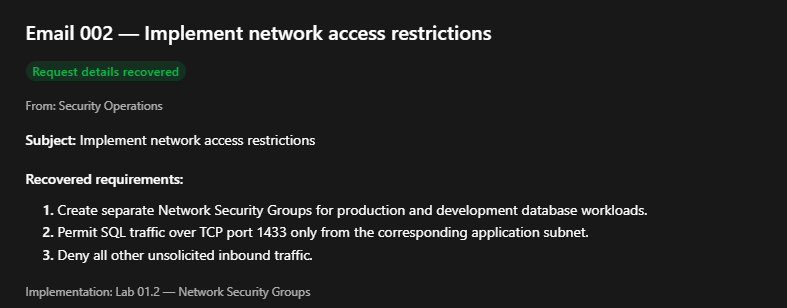

# Email 002 — Implement Network Access Restrictions

**Project:** [AZ-PRJ-001 — Azure Environment Foundation](../README.md)  
**Request Reference:** Email 002  
**Request Owner:** Security Operations  
**Subject:** Implement network access restrictions  
**Status:** Request Details Recovered — Date and Implementation Evidence Pending  
**Related Milestone:** Lab 01.2 / AZ-002 — Network Security Groups (pending creation)

---

## 1. Source Evidence

The supplied screenshot identifies the sender as **Security Operations** and preserves the recovered requirements below. It does not show a request date, implementation evidence, or formal acceptance criteria; none is inferred.

## 2. Recovered Requirements

1. Create separate Network Security Groups for production and development database workloads.
2. Permit SQL traffic over TCP port 1433 only from the corresponding application subnet.
3. Deny all other unsolicited inbound traffic.

## 3. Intended Implementation Scope

This request is the source record for Lab 01.2. The planned implementation case will document the NSG resources, rules, subnet associations, deployment evidence, and controlled validation results.

The request does not, by itself, prove that SQL traffic was tested successfully. The later implementation record must distinguish configured rules from verified network connectivity.

## 4. Traceability

| Recovered Requirement | Planned Implementation Evidence | Status |
|---|---|---|
| Separate production and development database NSGs | NSG resources and database-subnet associations | Pending implementation record |
| TCP 1433 from the matching application subnet only | Rule priorities, source CIDRs, protocol, and destination port | Pending implementation record |
| Deny unsolicited inbound traffic | Explicit deny rule and effective-rule validation | Pending implementation record |

## 5. Outstanding Evidence

Add or link the following when available:

- Terraform or Azure deployment evidence for both NSGs.
- NSG rule and subnet-association evidence.
- Authorised TCP 1433 test from each corresponding application subnet.
- Unauthorised-source test demonstrating the denied path.
- Formal acceptance evidence and relevant date information.

