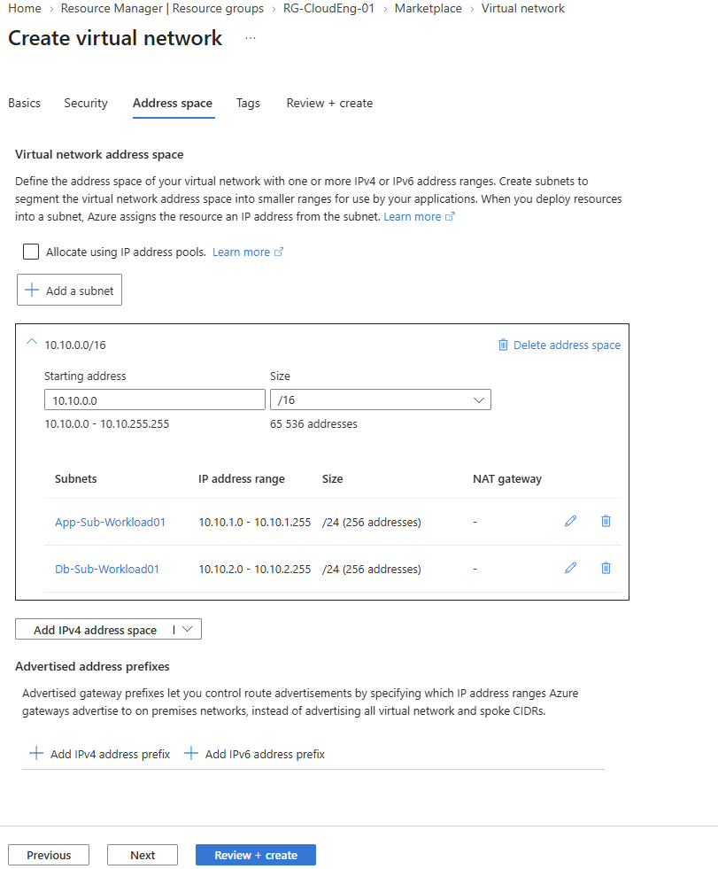
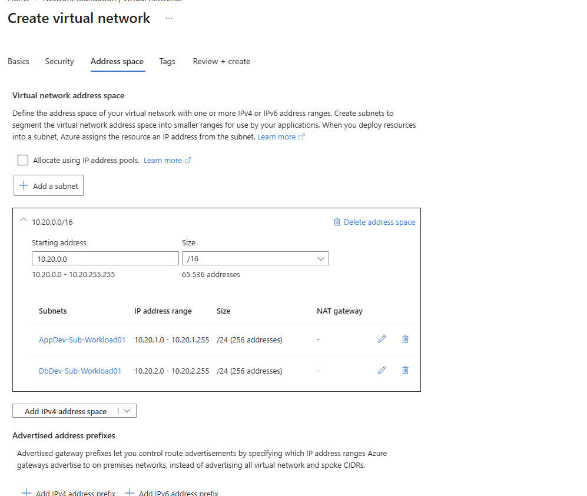
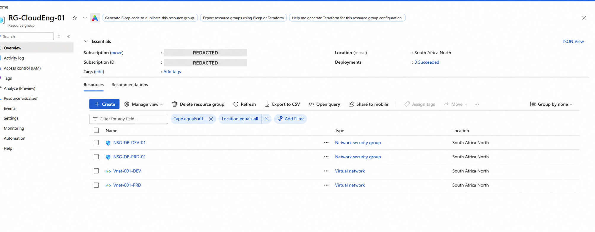
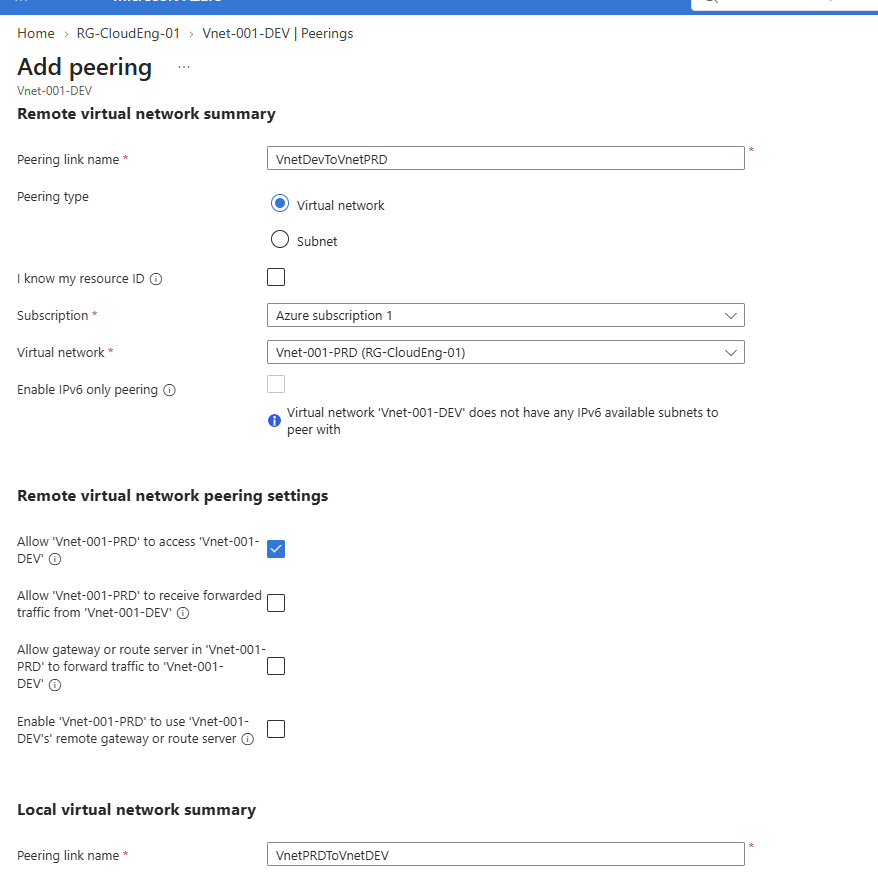
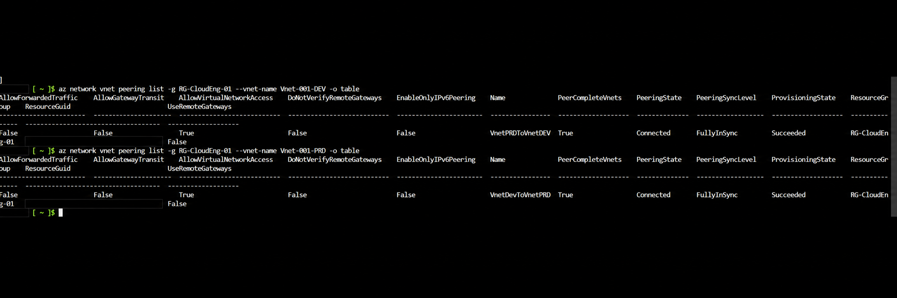
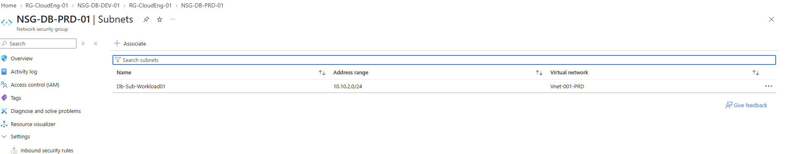
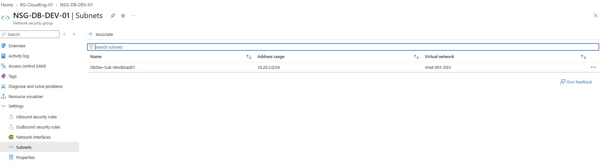
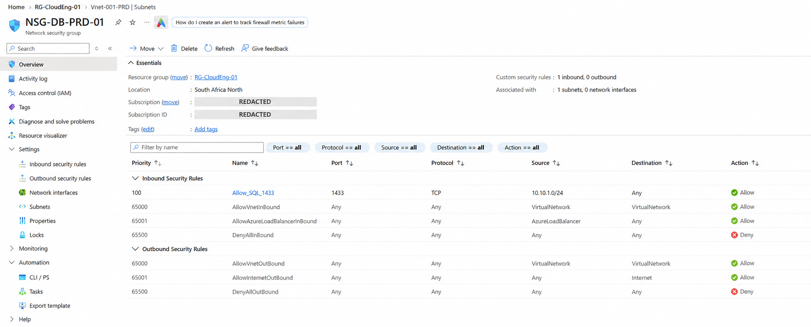
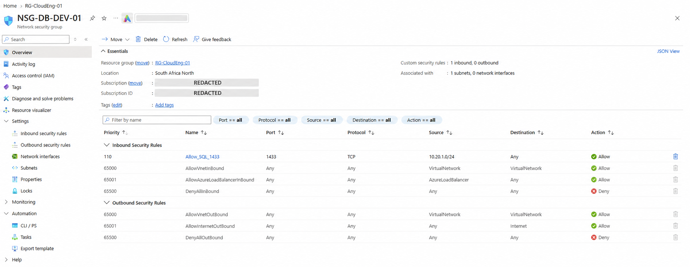
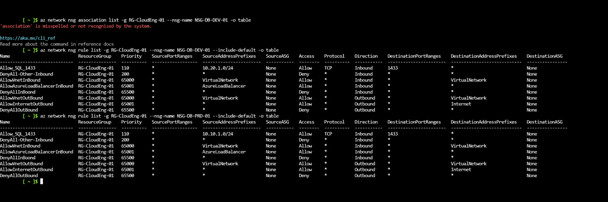

# AZ-001 — Azure Network Infrastructure Implementation

## 1. Document Information

| Field | Details |
|---|---|
| Project ID | AZ-PRJ-001 |
| Implementation ID | AZ-001 |
| Project | Azure Environment Foundation |
| Workstream | Network Infrastructure |
| Related requirement | Email-001-CTO-Initial-Network-Infrastructure.md |
| Resource Group | RG-CloudEng-01 |
| Azure Region | South Africa North |
| Implementation approach | Azure Portal |
| Status | Implemented — configuration verified |

---

## 2. Implementation Objective

Implement the initial Azure network foundation requested by the CTO.

The objective was to establish separate production and development network environments, create the required workload subnets, and configure VNet Peering to enable communication between the two environments.

The implementation was performed initially through the Azure Portal to demonstrate understanding of Azure networking components and their configuration.

## 3. Original Requirements

The CTO requested:

1. A production virtual network.
2. A development virtual network.
3. Separate IP address spaces.
4. Appropriate application workload subnets.
5. Communication between the VNets through VNet Peering.
6. Deployment in South Africa North.

The implementation also included database subnet segmentation and Network Security Groups (NSGs) to prepare the environment for subsequent workload deployment.

---

## 4. Network Architecture

### 4.1 Production Virtual Network



| Setting | Configuration |
|---|---|
| VNet Name | Vnet-001-PRD |
| Address Space | 10.10.0.0/16 |
| Region | South Africa North |
| Resource Group | RG-CloudEng-01 |

**Subnets**

| Subnet | Address Prefix | Purpose |
|---|---|---|
| App-Sub-Workload01 | 10.10.1.0/24 | Production application workloads |
| Db-Sub-Workload01 | 10.10.2.0/24 | Production database workloads |

### 4.2 Development Virtual Network



| Setting | Configuration |
|---|---|
| VNet Name | Vnet-001-DEV |
| Address Space | 10.20.0.0/16 |
| Region | South Africa North |
| Resource Group | RG-CloudEng-01 |

**Subnets**

| Subnet | Address Prefix | Purpose |
|---|---|---|
| AppDev-Sub-Workload01 | 10.20.1.0/24 | Development application workloads |
| DbDev-Sub-Workload01 | 10.20.2.0/24 | Development database workloads |

### 4.3 Address Space Separation

The production and development VNets use different, non-overlapping address spaces.

- Production: `10.10.0.0/16`
- Development: `10.20.0.0/16`

This avoids IP address overlap and provides room for future subnet expansion.

---

## 5. Implementation Activities

### 5.1 Resource Group



The existing resource group `RG-CloudEng-01` was used to contain the network resources for this implementation.

The resource group was confirmed to be deployed in South Africa North.

### 5.2 Production VNet Deployment

Created `Vnet-001-PRD` with the address space `10.10.0.0/16`.

Two subnets were created:

- `App-Sub-Workload01` — `10.10.1.0/24`
- `Db-Sub-Workload01` — `10.10.2.0/24`

### 5.3 Development VNet Deployment

Created `Vnet-001-DEV` with the address space `10.20.0.0/16`.

Two subnets were created:

- `AppDev-Sub-Workload01` — `10.20.1.0/24`
- `DbDev-Sub-Workload01` — `10.20.2.0/24`

### 5.4 VNet Peering

Configured bidirectional VNet Peering between the production and development networks.



| Local VNet | Peering Connection |
|---|---|
| Vnet-001-DEV | VnetDevToVnetPRD |
| Vnet-001-PRD | VnetPRDToVnetDEV |

**Peering configuration**

- Allow virtual network access: Enabled.
- Allow forwarded traffic: Disabled.
- Allow gateway transit: Disabled.
- Use remote gateway: Disabled.

**Validation result**

Azure CLI confirmed:

- Peering state: `Connected`
- Peering synchronization: `FullyInSync`
- Provisioning state: `Succeeded`

Both directions were checked.



### 5.5 Network Security Groups

Created two NSGs to provide separate security controls for the database subnets.

| NSG | Associated subnet |
|---|---|
| NSG-DB-PRD-01 | Db-Sub-Workload01 |
| NSG-DB-DEV-01 | DbDev-Sub-Workload01 |

Both NSGs were associated with their respective database subnets.





**SQL inbound rules**

| Setting | Production | Development |
|---|---|---|
| Rule name | Allow_SQL_1433 | Allow_SQL_1433 |
| Priority | 100 | 110 |
| Source | 10.10.1.0/24 | 10.20.1.0/24 |
| Destination | Any | Any |
| Protocol | TCP | TCP |
| Destination port | 1433 | 1433 |
| Action | Allow | Allow |





The rules permit SQL Server traffic from the corresponding application subnet to the database subnet.

A custom inbound deny rule was also configured during the implementation with priority 200 to deny other inbound traffic.

Azure's default inbound rules remain present. The final effective rule configuration should be checked against the Terraform configuration and current Azure state before treating this as a production security baseline.



**Outbound rules**

The NSGs retained Azure's default outbound rules, including the default Internet allow rule and the final deny-all rule.

No custom outbound restrictions were implemented at this stage.

---

## 6. Validation and Results

The following checks were performed during implementation.

| Validation | Result |
|---|---|
| Production VNet deployed | Successful |
| Development VNet deployed | Successful |
| Production address space configured | Confirmed |
| Development address space configured | Confirmed |
| Application subnets created | Confirmed |
| Database subnets created | Confirmed |
| NSGs created | Confirmed |
| NSGs associated with database subnets | Confirmed |
| SQL inbound rules configured | Confirmed |
| Production-to-development peering | Connected |
| Development-to-production peering | Connected |
| Peering synchronization | FullyInSync |
| Azure resource deployment | Succeeded |

### Validation commands

The Azure CLI was used to inspect the deployed network security rules:

```bash
az network nsg rule list \
  -g RG-CloudEng-01 \
  --nsg-name NSG-DB-DEV-01 \
  --include-default \
  -o table
```

```bash
az network nsg rule list \
  -g RG-CloudEng-01 \
  --nsg-name NSG-DB-PRD-01 \
  --include-default \
  -o table
```

VNet Peering was inspected using:

```bash
az network vnet peering list \
  -g RG-CloudEng-01 \
  --vnet-name Vnet-001-DEV \
  -o table
```

```bash
az network vnet peering list \
  -g RG-CloudEng-01 \
  --vnet-name Vnet-001-PRD \
  -o table
```

**Important validation limitation:** A `Connected` peering state confirms that the peering configuration is established. It does not independently prove application-level or SQL connectivity between virtual machines. End-to-end packet and service connectivity tests were not part of this initial validation.

---

## 7. Challenges and Lessons Learned

### 7.1 Azure CLI command structure

During validation, an incorrect command was attempted:

```bash
az vnet peering list
```

Azure CLI returned an error because the command hierarchy was incorrect.

The correct command is:

```bash
az network vnet peering list
```

**Lesson learned:** Azure CLI commands follow specific command groups and subgroups. Checking the command hierarchy and using CLI help prevents unnecessary troubleshooting.

### 7.2 NSG rule evaluation

The implementation introduced custom SQL allow rules and an inbound deny rule.

Azure evaluates NSG rules according to priority, with lower numbers evaluated first.

The SQL allow rules therefore need a higher precedence than the general deny rule.

**Lesson learned:** NSG rule priorities must be planned deliberately. A broad deny rule placed above a required allow rule can unintentionally block legitimate traffic.

### 7.3 Subnet-level NSG association

Creating an NSG does not automatically protect a subnet.

The NSG must be explicitly associated with the relevant subnet or network interface.

**Lesson learned:** Always verify the association after creating an NSG. The presence of an NSG resource alone does not prove that traffic is being filtered by it.

### 7.4 Peering is not the same as connectivity testing

Both peering connections reached `Connected` and `FullyInSync`.

However, this does not prove that an application or SQL Server service is reachable.

**Lesson learned:** Separate control-plane validation from data-plane validation. Resource status confirms configuration; traffic testing confirms actual communication.

### 7.5 Default NSG rules

Azure automatically creates default inbound and outbound security rules.

Custom rules take precedence when their priorities are higher.

**Lesson learned:** Understand the default rules before introducing custom rules. Avoid assuming that a custom rule is the only rule governing traffic.

---

## 8. Security Considerations and Outstanding Work

The implementation established initial segmentation, but it should not yet be considered a complete production network security design.

Outstanding considerations:

- Confirm the final custom inbound deny rule configuration on both NSGs.
- Review outbound access requirements and restrict unnecessary egress.
- Consider using Application Security Groups (ASGs) instead of relying only on subnet CIDRs as the environment grows.
- Consider central monitoring and NSG flow visibility.
- Perform end-to-end connectivity tests between application and database workloads.
- Review whether production and development should eventually use separate resource groups and stronger governance boundaries.
- Review routing and DNS requirements before deploying additional workloads.

---

## 9. Final Outcome

The initial Azure network foundation was successfully established.

The implementation delivered:

- Separate production and development VNets.
- Non-overlapping IP address spaces.
- Application and database subnet segmentation.
- Database subnet NSGs.
- SQL Server inbound access rules.
- Bidirectional VNet Peering.
- Deployment in South Africa North.

Azure confirmed that both peering connections were connected and fully synchronized.

This completed the initial network infrastructure implementation requested in Email 001 and provided the foundation for subsequent virtual machine and database workload deployment.

---

## 10. Related Documentation

- `01-Requirements/Email-001-CTO-Initial-Network-Infrastructure.md`
- `01-Requirements/Email-002-Security-Operations-Network-Requirements.md`
- `02-Implementation/AZ-002-Virtual-Machine-Deployment.md` *(planned / subsequent implementation)*

## 11. Evidence

Store approved, redacted screenshots in [images/AZ-001](../images/AZ-001/).

Only include screenshots that directly support the implementation claims. Remove subscription IDs, credentials, tokens, and other sensitive account information before committing evidence to GitHub.

---

**Implementation:** AZ-001 — Network Infrastructure
**Project:** AZ-PRJ-001 — Azure Environment Foundation
**Status:** Implemented — initial configuration verified
