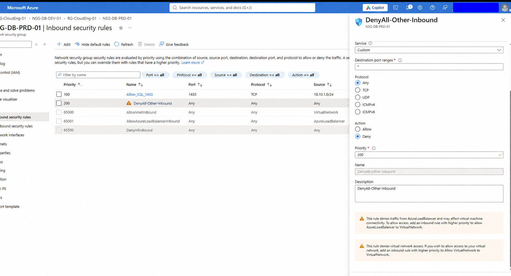

# AZ-002 — Network Security Groups and Database Access Restrictions

## 1. Document Information

| Field | Details |
|---|---|
| Project ID | AZ-PRJ-001 |
| Implementation ID | AZ-002 |
| Project | Azure Environment Foundation |
| Workstream | Network Security |
| Related requirement | Email-002-Security-Operations-Network-Requirements.md |
| Environment or scope | Production and Development database subnets |
| Region or location | South Africa North |
| Implementation approach | Azure Portal and Azure CLI validation |
| Status | Implemented — configuration verified |

---

## 2. Implementation Objective

Implement network access restrictions for the production and development database subnets.

The objective was to restrict SQL Server access to the corresponding application subnet while denying other unsolicited inbound traffic.

Separate Network Security Groups (NSGs) were implemented to maintain independent security controls for production and development environments.

## 3. Original Requirements

The Security Operations request required:

1. Create a separate NSG for the production database subnet.
2. Create a separate NSG for the development database subnet.
3. Permit TCP port 1433 only from the corresponding application subnet.
4. Deny all other unsolicited inbound traffic.

The implementation used the network infrastructure established in AZ-001.

---

## 4. Architecture and Configuration

### 4.1 Production Database Security

| Setting | Configuration |
|---|---|
| NSG Name | NSG-DB-PRD-01 |
| Resource Group | RG-CloudEng-01 |
| Region | South Africa North |
| Associated subnet | Db-Sub-Workload01 |
| Subnet address range | 10.10.2.0/24 |
| Application source range | 10.10.1.0/24 |

### 4.2 Development Database Security

| Setting | Configuration |
|---|---|
| NSG Name | NSG-DB-DEV-01 |
| Resource Group | RG-CloudEng-01 |
| Region | South Africa North |
| Associated subnet | DbDev-Sub-Workload01 |
| Subnet address range | 10.20.2.0/24 |
| Application source range | 10.20.1.0/24 |

### 4.3 Security Rule Design

The following custom inbound rules were configured.

| Environment | Rule | Priority | Source | Protocol | Port | Action |
|---|---|---:|---|---|---:|---|
| Production | Allow_SQL_1433 | 100 | 10.10.1.0/24 | TCP | 1433 | Allow |
| Development | Allow_SQL_1433 | 110 | 10.20.1.0/24 | TCP | 1433 | Allow |
| Both | DenyAll-Other-Inbound | 200 | Any | Any | Any | Deny |

The SQL allow rules have higher priority than the general inbound deny rule.

This ensures that matching SQL traffic from the corresponding application subnet is evaluated before the general deny rule.

---

## 5. Implementation Activities

### 5.1 Production NSG Creation

Created `NSG-DB-PRD-01` in `RG-CloudEng-01`, South Africa North.

The NSG was associated with:

`Vnet-001-PRD / Db-Sub-Workload01`

Configured the custom inbound SQL rule:

- Source: `10.10.1.0/24`
- Protocol: TCP
- Destination port: 1433
- Action: Allow
- Priority: 100

Configured the general inbound deny rule with priority 200.

### 5.2 Development NSG Creation

Created `NSG-DB-DEV-01` in the same resource group and region.

The NSG was associated with:

`Vnet-001-DEV / DbDev-Sub-Workload01`

Configured the custom inbound SQL rule:

- Source: `10.20.1.0/24`
- Protocol: TCP
- Destination port: 1433
- Action: Allow
- Priority: 110

Configured the general inbound deny rule with priority 200.

### 5.3 Subnet Associations

Both NSGs were explicitly associated with their respective database subnets.

This ensures that the subnet-level NSG rules are applied to traffic entering and leaving those subnets.

### 5.4 Azure Default Security Rules

Azure's default NSG rules remained present.

These included:

- AllowVnetInBound
- AllowAzureLoadBalancerInBound
- DenyAllInBound
- AllowVnetOutBound
- AllowInternetOutBound
- DenyAllOutBound

The custom inbound deny rule at priority 200 takes precedence over the default inbound rules with higher priority numbers.

No custom outbound rules were configured during this implementation.

---

## 6. Validation and Results

The Azure Portal and Azure CLI were used to verify the NSG configuration.

| Validation | Result |
|---|---|
| Production NSG created | Confirmed |
| Development NSG created | Confirmed |
| Production NSG associated with database subnet | Confirmed |
| Development NSG associated with database subnet | Confirmed |
| Production SQL inbound rule | Confirmed |
| Development SQL inbound rule | Confirmed |
| General inbound deny rule | Confirmed in CLI output |
| Default NSG rules inspected | Confirmed |

### Validation commands

The following commands were used to inspect the production and development NSG rules.

**Development NSG**

```bash
az network nsg rule list \
  -g RG-CloudEng-01 \
  --nsg-name NSG-DB-DEV-01 \
  --include-default \
  -o table
```

**Production NSG**

```bash
az network nsg rule list \
  -g RG-CloudEng-01 \
  --nsg-name NSG-DB-PRD-01 \
  --include-default \
  -o table
```

The initial attempt to inspect NSG associations used an unsupported CLI command group. The rule-list command was used successfully to inspect the rules, while subnet associations were confirmed through the Azure Portal.

**Validation limitations:**

The checks confirmed the deployed NSG rules and subnet associations. They did not establish that SQL Server connectivity worked from an application VM or that all other traffic was blocked at the application level. End-to-end traffic testing was not performed as part of this implementation.

---

## 7. Challenges and Lessons Learned

### 7.1 Azure CLI command hierarchy

- **Observed:** An attempted NSG association command using `az network nsg association list` was not recognized.
- **Resolution:** Used the supported NSG rule-list command for rule inspection and the Azure Portal to verify subnet associations.
- **Lesson:** Azure CLI command groups are specific. Check available commands before assuming that a resource supports a particular command structure.

### 7.2 NSG priority evaluation

- **Observed:** The implementation required SQL traffic to be allowed while other inbound traffic was denied.
- **Resolution:** Configured SQL allow rules at priorities 100 and 110, followed by the general deny rule at priority 200.
- **Lesson:** Lower numerical priority values are evaluated first. Rule ordering is essential when implementing restrictive firewall policies.

### 7.3 Azure default inbound rules

- **Observed:** Azure automatically provides default rules for virtual network and Azure Load Balancer traffic.
- **Resolution:** Inspected the default rules alongside the custom rules.
- **Lesson:** Custom rules can override default behaviour when they have a higher evaluation priority. Always inspect the complete effective rule set rather than reviewing custom rules in isolation.

### 7.4 Azure Load Balancer warning

- **Observed:** Azure displayed a warning that the general inbound deny rule could affect Azure Load Balancer traffic.
- **Resolution:** The warning was reviewed during configuration. No separate Azure Load Balancer traffic test was performed.
- **Lesson:** Broad deny rules can affect platform-related traffic. Any required platform or service traffic should be explicitly assessed and allowed with a higher-priority rule where appropriate.



---

## 8. Security Considerations and Outstanding Work

The implementation established subnet-level inbound restrictions for the database environments.

Outstanding considerations:

- Confirm whether any Azure platform or load-balancer traffic needs explicit allowance before deploying dependent services.
- Review outbound traffic requirements and implement egress restrictions where appropriate.
- Perform connectivity testing from the production and development application subnets.
- Confirm that SQL Server is not exposed through public IP addresses or unintended network paths.
- Consider Network Watcher and NSG flow visibility for future troubleshooting and monitoring.
- Review and maintain separate production and development security policies as the environment grows.

The custom inbound deny rule is a broad restriction. It should be reviewed against the actual workload requirements before being treated as a production baseline.

---

## 9. Final Outcome

Separate production and development database NSGs were created and associated with their respective database subnets.

The implementation established:

- Independent database subnet security controls.
- SQL Server TCP 1433 access rules scoped to the corresponding application subnet.
- General inbound deny rules.
- Verification of custom and default NSG rules through Azure CLI.
- Verification of subnet associations through the Azure Portal.

The configuration requirements from Email 002 were implemented and verified at the Azure configuration level.

End-to-end traffic testing and further security hardening remain outstanding.

---

## 10. Related Documentation

- `01-Requirements/Email-001-CTO-Initial-Network-Infrastructure.md`
- `01-Requirements/Email-002-Security-Operations-Network-Requirements.md`
- `02-Implementation/AZ-001-Network-Infrastructure.md`

---

## 11. Evidence

Store approved, redacted evidence in the [AZ-001 images folder](../images/AZ-001/) and [AZ-002 images folder](../images/AZ-002/).


---

**Implementation:** AZ-002 — Network Security Groups
**Project:** AZ-PRJ-001 — Azure Environment Foundation
**Status:** Implemented — configuration verified
