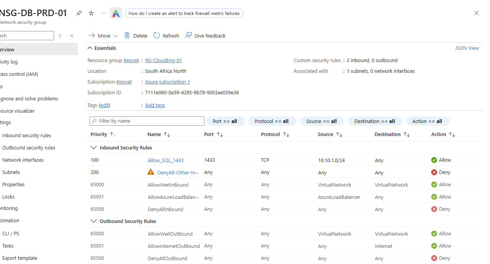
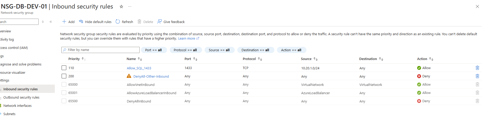

# AZ-002 — Network Security Groups

**Project:** [AZ-PRJ-001 — Azure Environment Foundation](../README.md)  
**Case ID:** AZ-002  
**Request Reference:** [Email 002 — Implement Network Access Restrictions](../01-Requirements/Email-002-Implement-Network-Access-Restrictions.md)  
**Platform:** Microsoft Azure  
**Region:** South Africa North  
**Resource Group:** RG-CloudEng-01  
**Implementation Approach:** Azure Portal evidence, Azure CLI rule listing, and supplied Terraform context  
**Status:** Implemented Configuration Documented — End-to-End Connectivity Tests Pending

---

## 1. Overview

This milestone implemented subnet-level Network Security Groups (NSGs) for the production and development database workloads. It responds to the Security Operations request to restrict inbound database access to SQL Server traffic from each environment's corresponding application subnet.

Two NSGs were configured and associated with the database subnets:

| Environment | NSG | Associated Database Subnet | Virtual Network |
|---|---|---|---|
| Production | `NSG-DB-PRD-01` | `Db-Sub-Workload01` (`10.10.2.0/24`) | `Vnet-001-PRD` |
| Development | `NSG-DB-DEV-01` | `DbDev-Sub-Workload01` (`10.20.2.0/24`) | `Vnet-001-DEV` |

## 2. Business Request and Design Response

Email 002 required separate NSGs for the production and development database workloads, SQL access over TCP 1433 only from the corresponding application subnet, and denial of other unsolicited inbound traffic.

The implementation uses a specific allow rule with a lower numerical priority than a broad custom deny rule. Azure evaluates NSG rules by priority, so the SQL allow rule is evaluated first.

| Environment | Allow Rule | Priority | Source | Protocol | Destination Port | Action |
|---|---|---:|---|---|---:|---|
| Production | `Allow_SQL_1433` | 100 | `10.10.1.0/24` | TCP | 1433 | Allow |
| Development | `Allow_SQL_1433` | 110 | `10.20.1.0/24` | TCP | 1433 | Allow |

Both NSGs also contain the custom inbound rule below.

| Rule | Priority | Source | Protocol | Destination Port | Action |
|---|---:|---|---|---:|---|
| `DenyAll-Other-Inbound` | 200 | Any | Any | Any | Deny |

## 3. Implementation Evidence

### Production NSG Rules

The portal evidence shows `NSG-DB-PRD-01` with the SQL allow rule at priority 100 and the custom deny rule at priority 200.

### Development NSG Rules

The portal evidence shows `NSG-DB-DEV-01` with the SQL allow rule at priority 110 and the custom deny rule at priority 200.

### Database-Subnet Associations

`NSG-DB-PRD-01` is associated with `Db-Sub-Workload01` in `Vnet-001-PRD`.

`NSG-DB-DEV-01` is associated with `DbDev-Sub-Workload01` in `Vnet-001-DEV`.

## 4. Infrastructure as Code Evidence Boundary

The supplied `C:\Terraform-Pro\LAB1.3\main.tf` was reviewed as later infrastructure context. It references the production and development virtual networks and the application and database subnets used by this milestone, but it does **not** contain `azurerm_network_security_group`, `azurerm_network_security_rule`, or NSG subnet-association resources.

It is therefore not used as evidence that Terraform created the Lab 01.2 NSG rules. The implementation claims in this case are based on the supplied Azure Portal and Azure CLI evidence. To make this milestone fully reproducible through IaC, retain or export the Lab 01.2 Terraform configuration or state-backed deployment record.

## 5. Validation and Results

The Azure Portal evidence confirms:

- Both NSGs exist in `RG-CloudEng-01` in South Africa North.
- Each NSG has one SQL allow rule and one custom deny rule.
- The production and development NSGs are associated with their intended database subnets.

Azure CLI rule-list output was also captured for both NSGs. A first attempt to use `az network nsg association list` returned an unrecognised-command error. The subsequent `az network nsg rule list -g RG-CloudEng-01 --nsg-name <NSG name> --include-default -o table` command successfully listed the custom and default rules for both NSGs.

This validates rule configuration, not packet flow. No supplied evidence demonstrates a successful TCP 1433 connection from each authorised application subnet or a failed connection from an unauthorised source.

## 6. Security Considerations

The custom deny rule at priority 200 is evaluated before Azure's default inbound rules, including `AllowVnetInBound` and `AllowAzureLoadBalancerInBound` at priorities 65000 and 65001. The Azure Portal warns that this configuration can deny virtual-network and Azure Load Balancer traffic.

This may be appropriate for a tightly restricted database subnet, but it is broader than merely blocking unsolicited Internet traffic. Before relying on this policy for a workload, test all required flows and add narrowly scoped higher-priority allow rules only when justified.

## 7. Challenges and Troubleshooting

| Observation | Impact | Resolution / Lesson |
|---|---|---|
| `az network nsg association list` was not recognised by Azure CLI. | The attempted command did not verify associations. | Use Azure Portal association evidence or an appropriate supported Azure CLI query; use `az network nsg rule list` only for rule enumeration. |
| The custom deny rule triggers Azure Portal warnings about virtual-network and Azure Load Balancer traffic. | Required internal traffic could be blocked. | Treat the warning as a design constraint and validate intended flows before production reliance. |

## 8. Outstanding Validation

1. Test TCP 1433 from `10.10.1.0/24` to the production database workload.
2. Test TCP 1433 from `10.20.1.0/24` to the development database workload.
3. Test that an unauthorised source cannot reach TCP 1433 on either database workload.
4. Review whether Azure Load Balancer or additional virtual-network flows require a justified exception.
5. Add the original Lab 01.2 Terraform files if the implementation must be reproduced from code.

## 9. Lessons Learned

- Associate database NSGs at the subnet level when the policy applies to the entire database tier.
- Use explicit rule priorities to allow only the required SQL path before applying a broad deny rule.
- A rule shown in the portal is configuration evidence, not proof of successful application connectivity.
- Validate Azure CLI commands before relying on them for evidence collection.
- Preserve the milestone-specific Terraform source; a later configuration that only references existing subnets cannot prove how their NSGs were created.

## 10. Related Records

- [Email 002 — Implement Network Access Restrictions](../01-Requirements/Email-002-Implement-Network-Access-Restrictions.md)
- [AZ-001 — Network Infrastructure](AZ-001-Network-Infrastructure.md)
- AZ-003 — Virtual Machine Deployment — pending creation

---

**Document Owner:** Nhlanhla  
**Knowledge Base Reference:** AZ-002  
**Category:** Azure Cloud / Implementation Projects

