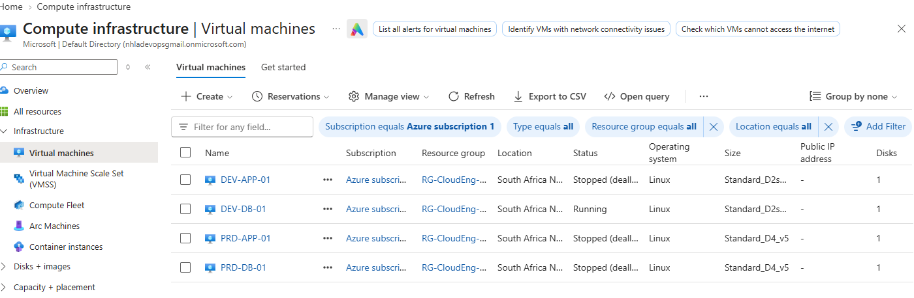
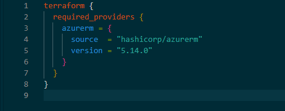
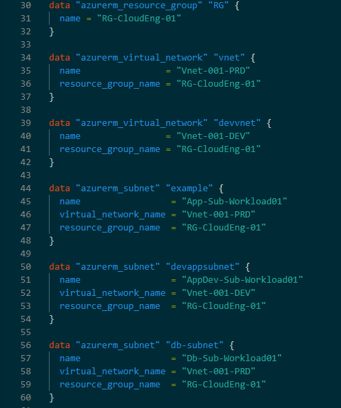
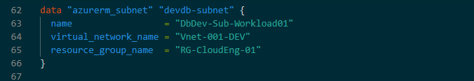
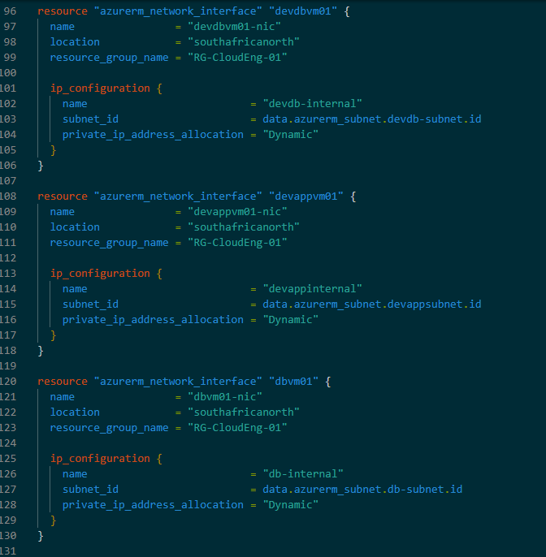
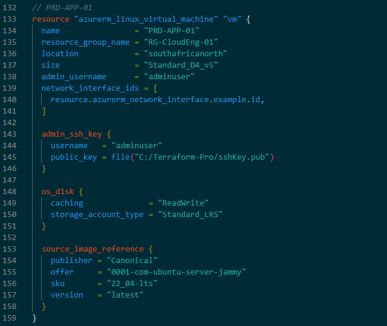
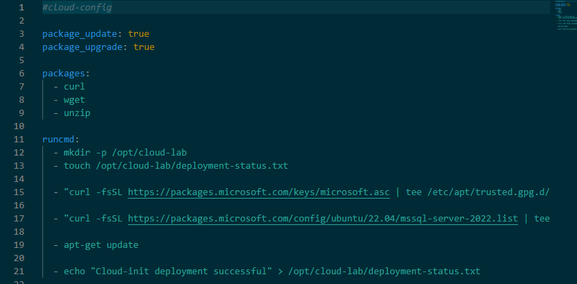
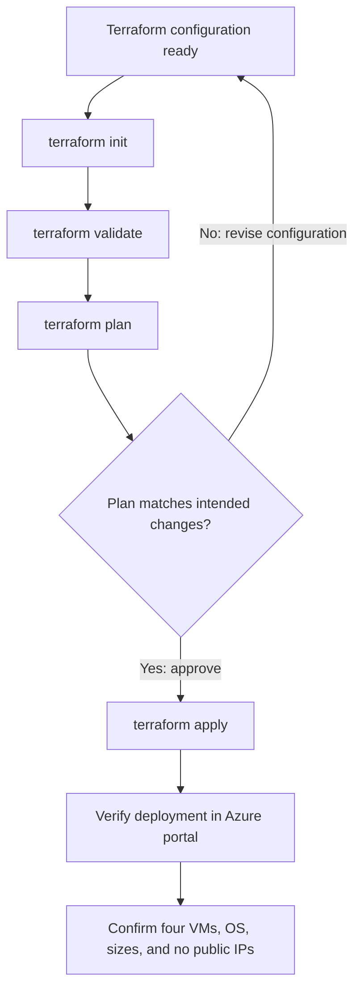

# AZ-003 — Terraform-Based Virtual Machine Provisioning

## 1. Document Information

| Field | Details |
|---|---|
| Document ID | AZ-003 |
| Project | AZ-PRJ-001 — Azure Environment Foundation |
| Category | Azure Cloud / Infrastructure as Code |
| Implementation area | Terraform-based compute provisioning |
| Azure resource group | `RG-CloudEng-01` |
| Azure region | South Africa North |
| Terraform provider | `hashicorp/azurerm` |
| Provider version | `5.14.0` |
| Status | Completed — initial VM deployment |
| Related request | CTO Email 001 — Initial Network Infrastructure; CTO Email 002 — Security and Operations requirements |

**Repository location**

`01-Azure-Cloud/08-Implementation-Projects/AZ-PRJ-001-Azure-Environment-Foundation/02-Implementation/AZ-003-Terraform-Based-Virtual-Machine-Provisioning.md`

---

## 2. Implementation Objective

Following the establishment of the initial Azure network foundation and the security rules, the next implementation step was to provision the project’s virtual machines using Terraform.

The objective was to move the compute deployment into Infrastructure as Code (IaC), reference the network resources that had already been created in Azure, and deploy the production and development virtual machines into their intended subnets.

This implementation introduced the Terraform workflow and the AzureRM provider, including the use of data sources, resource blocks, resource references, outputs, and VM configuration.

**Scope boundary:** This document records the initial Terraform-based VM provisioning work. Later changes to DEV-DB-01—including its system-assigned managed identity, Key Vault permissions, NAT Gateway connectivity, and SQL Server preparation—are separate follow-on activities and are not presented as part of the original deployment.

---

## 3. Original Requirements

The initial network and workload requirements came from the CTO’s environment-preparation requests.

The network foundation established in the preceding implementation provided:

- Separate production and development virtual networks.
- Separate IP address spaces for the two environments.
- Application and database subnets.
- VNet peering between production and development.
- Deployment in South Africa North.
- Database subnet network security groups with SQL traffic restricted to the relevant application subnet.

The Terraform implementation built on that foundation by provisioning the four workload VMs and their network interfaces.

The initial compute deployment was expected to provide:

1. A production application VM.
2. A production database VM.
3. A development application VM.
4. A development database VM.
5. Network interfaces connected to the appropriate existing subnets.
6. Ubuntu Server 22.04 LTS as the operating system image.
7. SSH public-key authentication for VM administration.
8. Initial automated configuration for the development database VM using cloud-init.

---

## 4. Architecture and Configuration

### 4.1 Deployment overview

Terraform was used to provision the compute resources inside the existing resource group and network foundation.

| Environment | Workload | VM name | VM size | Subnet |
|---|---|---|---|---|
| Production | Application | `PRD-APP-01` | `Standard_D4_v5` | `App-Sub-Workload01` |
| Production | Database | `PRD-DB-01` | `Standard_D4_v5` | `Db-Sub-Workload01` |
| Development | Application | `DEV-APP-01` | `Standard_D2s_v5` | `AppDev-Sub-Workload01` |
| Development | Database | `DEV-DB-01` | `Standard_D2s_v5` | `DbDev-Sub-Workload01` |

All four VMs used the Canonical Ubuntu Server 22.04 LTS (Jammy) image.



### 4.2 Terraform provider

The AzureRM provider was used to manage Azure resources through Terraform.

The provider version was pinned to `5.14.0` in the Terraform configuration:

```hcl
terraform {
  required_providers {
    azurerm = {
      source  = "hashicorp/azurerm"
      version = "5.14.0"
    }
  }
}

provider "azurerm" {
  features {}
}
```



Pinning the provider version helps keep deployments consistent and reduces unexpected behaviour caused by unplanned provider upgrades.

### 4.3 Existing Azure resources referenced by Terraform

The VNet and subnet infrastructure had already been created. Terraform therefore used `data` blocks to look up those existing resources rather than creating duplicate networks.

The configuration referenced:

- `RG-CloudEng-01`
- `Vnet-001-PRD`
- `Vnet-001-DEV`
- `App-Sub-Workload01`
- `Db-Sub-Workload01`
- `AppDev-Sub-Workload01`
- `DbDev-Sub-Workload01`





This demonstrated the difference between:

- **Data sources (`data`)** — retrieve information about resources that already exist.
- **Managed resources (`resource`)** — define resources Terraform is responsible for creating or managing.

### 4.4 Network interfaces

Four Azure network interfaces were defined, each referencing the appropriate subnet ID returned by a Terraform subnet data source.

Private IP allocation was configured as `Dynamic`.

| Network interface | Connected subnet |
|---|---|
| `appvm01-nic` | Production application subnet |
| `dbvm01-nic` | Production database subnet |
| `devappvm01-nic` | Development application subnet |
| `devdbvm01-nic` | Development database subnet |



### 4.5 Virtual machine configuration

Each VM was defined using the `azurerm_linux_virtual_machine` resource.

The configuration included:

- VM name, location, resource group, and size.
- The network interface ID.
- Linux administrator username.
- SSH public key.
- Managed OS disk configuration using `Standard_LRS`.
- Canonical Ubuntu 22.04 LTS image reference.



The public key was loaded from a local file path in the original Terraform configuration. The private SSH key was not part of the Terraform configuration and must never be committed to the repository.

### 4.6 Initial cloud-init configuration

The initial configuration supplied custom data to `DEV-DB-01` using Terraform's `base64encode()` function and a cloud-init YAML file.

This introduced first-boot automation: the VM could receive its initial Linux configuration as part of provisioning rather than relying entirely on manual post-deployment steps.

The later cloud-init work to configure outbound package access and prepare the VM for SQL Server is documented separately. This document records only the initial integration of the cloud-init file with the VM resource.



---

## 5. Implementation Activities

### 5.1 Prepared the Terraform working directory

A Terraform working directory was created for the Azure VM deployment. The configuration was separated into Terraform files, including the provider configuration and the main infrastructure configuration.

The AzureRM provider was declared and pinned to version `5.14.0`.

### 5.2 Referenced the existing network foundation

Terraform data sources were added to retrieve the existing resource group, VNets, and subnets.

This allowed the VM deployment to use the network foundation already established in the earlier implementation.

### 5.3 Defined the network interfaces

Four NIC resources were created. Each NIC referenced the subnet ID of its intended workload subnet.

Dynamic private IP allocation was used for the NIC IP configurations.

### 5.4 Defined the four virtual machines

The four Linux VM resources were configured with the selected VM sizes, Ubuntu image, OS disk settings, administrator account, SSH public key, and NIC references.

The production VMs used `Standard_D4_v5`; the development VMs used `Standard_D2s_v5`.

### 5.5 Integrated cloud-init for DEV-DB-01

The development database VM resource referenced the cloud-init YAML file through `custom_data`.

Terraform encoded the file content as Base64 before passing it to the Azure VM resource.

### 5.6 Reviewed and deployed the Terraform configuration

The Terraform workflow was used to review and apply the infrastructure configuration.

The deployment was then checked in the Azure portal. The VM inventory showed the four expected VM names, their operating systems, their selected sizes, and no public IP addresses assigned in the displayed inventory.



---

## 6. Validation and Results

The following results were visible in the supplied Azure portal evidence and the implementation history.

| Validation item | Expected result | Result |
|---|---|---|
| Production application VM | `PRD-APP-01` provisioned | Confirmed in VM inventory |
| Production database VM | `PRD-DB-01` provisioned | Confirmed in VM inventory |
| Development application VM | `DEV-APP-01` provisioned | Confirmed in VM inventory |
| Development database VM | `DEV-DB-01` provisioned | Confirmed in VM inventory |
| VM operating system | Linux / Ubuntu | Shown in VM inventory; Ubuntu 22.04 LTS configured in Terraform |
| VM sizing | Production D4_v5; development D2s_v5 | Shown in Terraform configuration and VM inventory |
| Public IP assignment | No public IP on the four VMs | Shown as `-` in the supplied VM inventory |
| NIC subnet placement | Each VM attached to its intended workload subnet | Defined through Terraform NIC-to-subnet references |
| Initial cloud-init integration | Custom data supplied to DEV-DB-01 | Confirmed in Terraform configuration |

**Validation qualification:** The screenshots confirm that the four VMs were present in Azure and show their sizes and public IP status. The Terraform configuration demonstrates the intended NIC-to-subnet mappings. This document does not claim that application-to-database traffic or end-to-end workload connectivity was tested as part of this deployment.

---

## 7. Challenges and Lessons Learned

### 7.1 Understanding Terraform data sources and resources

A key learning point was understanding when to use a `data` block and when to use a `resource` block.

The VNets and subnets already existed, so Terraform retrieved their details through data sources. The NICs and VMs were new resources, so they were declared as managed resources.

**Lesson:** Terraform can manage new infrastructure while also integrating with infrastructure that already exists.

### 7.2 Resource references and dependency ordering

The NIC resources referenced subnet IDs returned by data sources. The VM resources then referenced the NIC IDs.

These references establish relationships between resources and allow Terraform to determine the required dependency order.

**Lesson:** Prefer resource references over hard-coded Azure resource IDs. References make the configuration easier to maintain and help Terraform understand dependencies.

### 7.3 Terraform plan and apply workflow

The implementation introduced the importance of reviewing a Terraform plan before applying changes.

- `terraform init` prepares the working directory and downloads the required provider.
- `terraform validate` checks the configuration for syntax and structural errors.
- `terraform plan` previews the proposed infrastructure changes.
- `terraform apply` executes the approved changes.

**Lesson:** A successful plan is not the same as a successful deployment. The apply result and the deployed Azure resources must also be checked.

### 7.4 Reproducibility and local dependencies

The original configuration referenced a local SSH public-key file and a cloud-init file. These files must be available at the paths expected by the Terraform configuration.

**Lesson:** A reusable Terraform project must document its file dependencies and avoid committing private keys or other secrets.

### 7.5 Infrastructure lifecycle awareness

Terraform manages infrastructure over time, not just during the initial deployment. Changes to certain VM properties can result in an in-place update or resource replacement.

**Lesson:** Always inspect the plan carefully, especially when a change may replace a VM or affect persistent data. Treat production and development resources with appropriate caution.

---

## 8. Security Considerations and Outstanding Work

The initial deployment included several security-conscious decisions:

- The VMs were not assigned public IP addresses in the supplied deployment evidence.
- SSH public-key authentication was configured rather than documenting a password-based administrator login.
- The VMs were placed into separate production and development network segments.
- Database subnet security was handled through the previously created NSGs.
- The private SSH key was not included in the Terraform configuration.

The following items are deliberately outside the scope of this implementation record:

- System-assigned managed identity for `DEV-DB-01`.
- Key Vault creation and the VM's Key Vault Secrets User role assignment.
- NAT Gateway and static public IP deployment for development database subnet outbound connectivity.
- SQL Server 2022 installation and configuration.
- Subsequent cloud-init revisions and package installation troubleshooting.

These were follow-on activities undertaken after the initial Terraform VM deployment and should be recorded in their own implementation documents or later project phases.

**Operational consideration:** The VM sizes used here were selected for the lab implementation. They should not be treated as a production sizing recommendation without workload, availability, performance, and cost assessment.

---

## 9. Final Outcome

The initial Terraform-based compute deployment was completed.

Four Ubuntu Linux virtual machines were provisioned across the existing production and development network foundation:

- `PRD-APP-01`
- `PRD-DB-01`
- `DEV-APP-01`
- `DEV-DB-01`

The implementation established the foundation for managing Azure compute resources through Terraform and demonstrated how Terraform can reference existing Azure networking resources while provisioning new NICs and VMs.

It also introduced cloud-init as a mechanism for passing initial configuration to a Linux VM during provisioning.

This milestone marked the transition from portal-led infrastructure creation to repeatable, code-driven infrastructure provisioning.

---

## 10. Related Documentation

| Document | Relationship |
|---|---|
| `README.md` — AZ-PRJ-001 Azure Environment Foundation | Project overview and implementation index |
| `AZ-001-Network-Infrastructure.md` | Initial network infrastructure implementation |
| [AZ-002-Network-Security-Groups.md](AZ-002-Network-Security-Groups.md) | Network security group and database subnet security implementation |
| CTO Email 001 — Initial Network Infrastructure | Original environment foundation request |
| CTO Email 002 — Security and Operations | Follow-up security and operational requirements |
| `cloud-init/dev-db-init.yml` | Initial cloud-init configuration supplied to DEV-DB-01 |

---

## 11. Evidence

Store approved, redacted evidence in the [AZ-003 images folder](../images/AZ-003/).

- [VM deployment verification](../images/AZ-003/01_vm_verification.png)
- [Terraform provider configuration](../images/AZ-003/02_terraform_provider.png)
- [Terraform data sources](../images/AZ-003/03_data_resource.png)
- [Development subnet data source](../images/AZ-003/04_data_resource_devsubnet.png)
- [Terraform virtual machine configuration](../images/AZ-003/05_virtual_machine_configuration.png)
- [Terraform cloud-init configuration](../images/AZ-003/06_cloud_init_configuration.png)
- [Terraform network interface configuration](../images/AZ-003/07_nic.png)

---

**Implementation:** AZ-003 — Terraform-Based Virtual Machine Provisioning
**Project:** AZ-PRJ-001 — Azure Environment Foundation
**Status:** Completed — initial VM deployment
