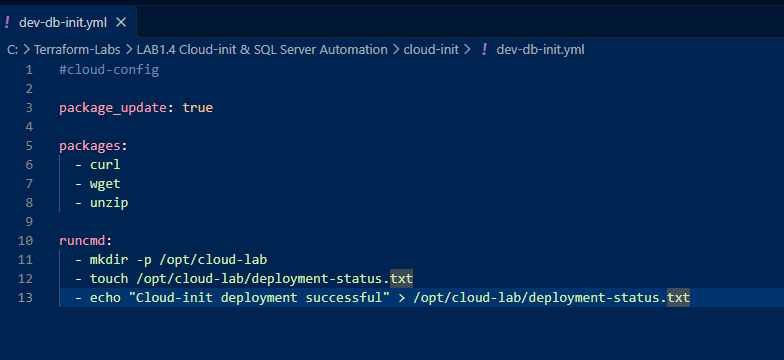
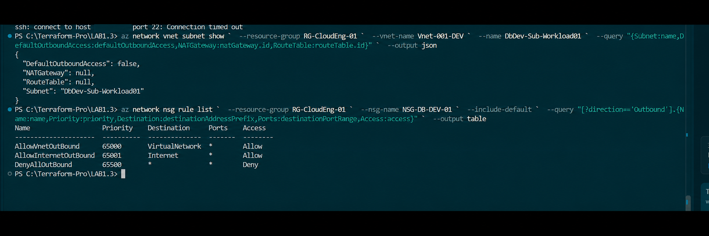
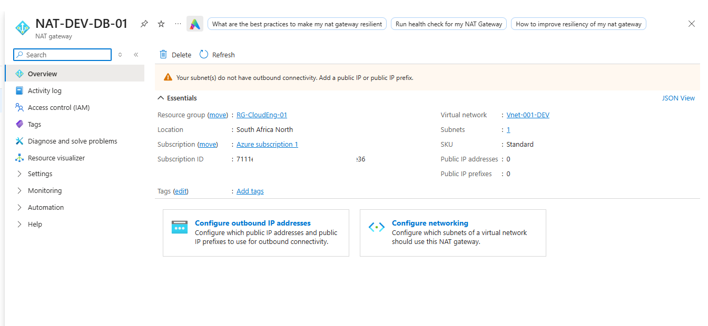
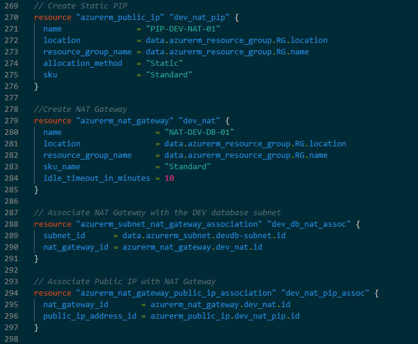
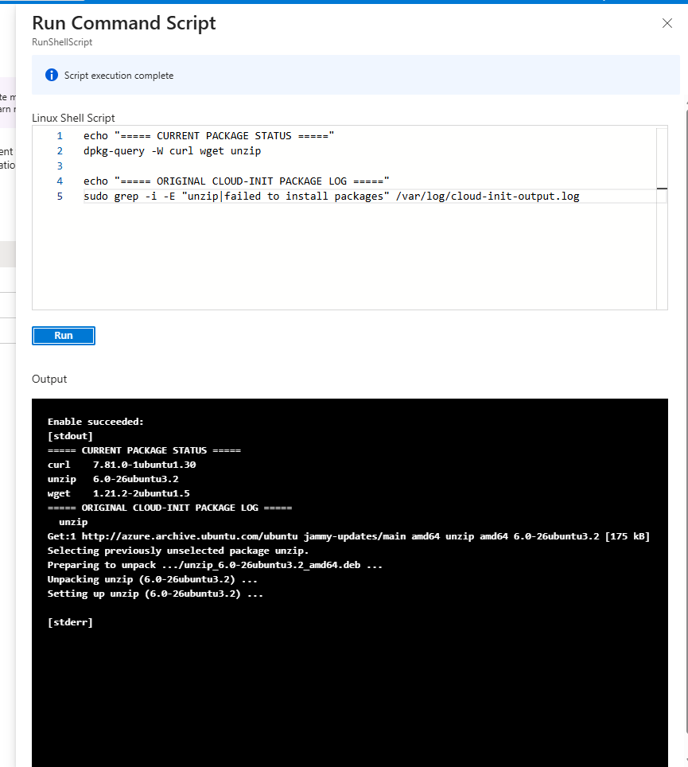

# AZ-004 — Cloud-init Configuration and Outbound Connectivity

## 1. Document Information

| Field | Details |
|---|---|
| Document ID | AZ-004 |
| Project | AZ-PRJ-001 — Azure Environment Foundation |
| Category | Azure Cloud / Infrastructure as Code |
| Implementation area | Linux automation and network egress |
| Azure resource group | `RG-CloudEng-01` |
| Azure region | South Africa North |
| Target VM | `DEV-DB-01` |
| Terraform provider | `hashicorp/azurerm` |
| Provider version | `5.14.0` |
| Status | Completed — outbound connectivity verified |
| Related implementation | AZ-003 — Terraform-Based Virtual Machine Provisioning |

---

## 2. Implementation Objective

Following the initial Terraform deployment of the four virtual machines, the next step was to configure the development database VM using cloud-init and establish the outbound connectivity required for automated package installation.

The objective was to:

- Automate initial Ubuntu configuration using cloud-init.
- Install required Linux utilities during VM initialization.
- Investigate and resolve package installation failures.
- Establish controlled outbound Internet connectivity for the development database subnet.
- Manage the networking changes through Terraform.

This implementation focused on `DEV-DB-01` and its associated database subnet.

**Scope boundary:** This document covers cloud-init configuration, outbound connectivity troubleshooting and NAT Gateway deployment. SQL Server installation, managed identity configuration and Key Vault integration are documented as subsequent implementation activities.

---

## 3. Original Requirements

The development database VM had been provisioned during AZ-003.

The next implementation activity required the VM to be configured automatically and to retrieve the packages needed for subsequent workload preparation.

The technical objectives were:

1. Configure cloud-init for the Ubuntu development database VM.
2. Enable package index updates.
3. Install required utilities, including `curl`, `wget` and `unzip`.
4. Investigate why package downloads were failing.
5. Establish outbound connectivity for the development database subnet.
6. Manage the required Azure networking resources through Terraform.

These were follow-on engineering activities within the Azure Environment Foundation project, not a third original business email request.

---

## 4. Architecture and Configuration

### 4.1 Target workload

| Setting | Configuration |
|---|---|
| VM name | `DEV-DB-01` |
| Operating system | Ubuntu Server 22.04 LTS |
| VM size | `Standard_D2s_v5` |
| VNet | `Vnet-001-DEV` |
| Subnet | `DbDev-Sub-Workload01` |
| Subnet address range | `10.20.2.0/24` |
| Private IP observed | `10.20.2.4` |

### 4.2 Initial cloud-init configuration

Cloud-init was integrated into the Terraform Linux VM resource through the `custom_data` property.

The configuration was maintained in:

`LAB1.4/cloud-init/dev-db-init.yml`

The initial automation included:

- Package index updates.
- Package upgrades.
- Installation of required Linux utilities.
- First-boot commands through the `runcmd` section.

The utilities included:

| Package | Purpose |
|---|---|
| `curl` | Retrieve resources over HTTP and HTTPS |
| `wget` | Download files from remote sources |
| `unzip` | Extract ZIP archives |

Cloud-init runs during VM initialization. It is not a general-purpose configuration management system that automatically reruns the same initialization on every reboot.

### 4.3 Initial outbound connectivity design

The development database VM did not have a public IP address.

The subnet inspection showed:

| Setting | Observed configuration |
|---|---|
| Subnet | `DbDev-Sub-Workload01` |
| DefaultOutboundAccess | `false` |
| NAT Gateway | Not associated |
| Route table | None associated |
| NSG outbound rules | Default outbound Internet allowance present |

The NSG configuration allowed outbound Internet traffic, but this did not itself provide the VM with an outbound connectivity mechanism.

### 4.4 NAT Gateway design

A NAT Gateway was introduced to provide outbound Internet connectivity for the development database subnet.

| Resource | Name |
|---|---|
| NAT Gateway | `NAT-DEV-DB-01` |
| Public IP | `PIP-DEV-NAT-01` |
| Observed public IP address | `1.000.000.111` (example) |
| Associated subnet | `DbDev-Sub-Workload01` |
| Environment | Development |

The NAT Gateway was associated with a dedicated static public IP address and attached to the development database subnet.

This allowed outbound connections from workloads in that subnet without assigning public IP addresses directly to the virtual machines.

---

## 5. Implementation Activities

### 5.1 Configured cloud-init

The initial cloud-init YAML was created for the development database VM.

The configuration included package update and upgrade operations, installation of the required utilities and first-boot commands.

The Terraform VM configuration supplied the cloud-init file through `custom_data`.

### 5.2 Investigated package installation failure

During initialization, package installation did not complete successfully.

The VM was able to resolve the Ubuntu package repository hostname, but HTTP and HTTPS connections to retrieve packages timed out.

This indicated that DNS resolution was functioning while outbound network connectivity remained unavailable.

### 5.3 Inspected subnet networking

The development database subnet was inspected in Azure.

The investigation identified:

- `DefaultOutboundAccess` was set to `false`.
- No NAT Gateway was associated with the subnet.
- No route table was associated with the subnet.
- The NSG contained outbound rules allowing Internet traffic.

This helped isolate the problem: the NSG's outbound allowance did not provide the missing outbound connectivity path.

### 5.4 Deployed NAT Gateway through Terraform

The NAT Gateway was added to the Terraform configuration.

The implementation included:

1. Creation of a static public IP resource.
2. Creation of the NAT Gateway resource.
3. Association of the public IP with the NAT Gateway.
4. Association of the NAT Gateway with `DbDev-Sub-Workload01`.

The changes were reviewed and deployed through Terraform.

### 5.5 Verified outbound connectivity

After the NAT Gateway and public IP associations were deployed, outbound connectivity was tested again.

Package downloads and installation succeeded.

The required utilities were verified:

- `curl`
- `wget`
- `unzip`

This confirmed that the development database subnet could establish the outbound connections required for package installation.

---

## 6. Validation and Results

| Validation item | Expected result | Result |
|---|---|---|
| Cloud-init supplied to DEV-DB-01 | Custom data configured | Confirmed |
| Ubuntu DNS resolution | Repository hostname resolves | Successful |
| Initial HTTP/HTTPS package downloads | Repository reachable | Failed — timed out |
| Subnet outbound configuration inspected | Identify missing egress path | Completed |
| NAT Gateway deployed | NAT resource provisioned | Successful |
| Static public IP associated | NAT Gateway has public IP | Confirmed |
| NAT Gateway associated with subnet | Development DB subnet uses NAT | Confirmed |
| Outbound package retrieval | Downloads complete | Successful |
| `curl` installation | Package installed | Successful |
| `wget` installation | Package installed | Successful |
| `unzip` installation | Package installed | Successful |

### Validation observations

The initial tests demonstrated that DNS resolution and outbound connectivity are separate network functions.

The hostname resolved successfully, but package downloads timed out.

After NAT Gateway deployment and subnet association, the package downloads and installations succeeded.

**Validation limitation:** These results confirm successful outbound package retrieval from the development database VM. They do not constitute a comprehensive network security assessment or prove connectivity to every external destination.

---

## 7. Challenges and Lessons Learned

### 7.1 DNS resolution versus outbound connectivity

**Observed issue:**

The VM successfully resolved the Ubuntu repository hostname, but HTTP and HTTPS package downloads timed out.

**Investigation:**

DNS resolution was checked separately from the actual network connection. The subnet's outbound configuration was then inspected.

**Resolution:**

A NAT Gateway was deployed and associated with the development database subnet.

**Lesson learned:**

Successful DNS resolution does not prove that a VM has Internet connectivity. Troubleshooting should distinguish name resolution, routing, outbound translation and remote service availability.

### 7.2 NSG outbound rules do not create connectivity

**Observed issue:**

The NSG allowed outbound Internet traffic, but package downloads still failed.

**Investigation:**

The subnet had no NAT Gateway association and `DefaultOutboundAccess` was disabled.

**Resolution:**

A NAT Gateway with a static public IP was deployed.

**Lesson learned:**

An NSG controls which traffic is allowed or denied. It does not independently provide an outbound connectivity path or public IP translation.

### 7.3 Cloud-init execution and troubleshooting

**Observed issue:**

The initial automated package installation did not complete because the VM could not retrieve packages.

**Resolution:**

The outbound connectivity issue was addressed, after which package installation succeeded.

**Lesson learned:**

Cloud-init automation depends on the underlying network and repository availability. When initialization fails, inspect cloud-init logs and network connectivity rather than assuming the YAML syntax is the only possible cause.

### 7.4 Terraform resource dependencies

**Observed implementation requirement:**

The NAT Gateway required a public IP association and a subnet association.

**Resolution:**

The required Terraform association resources were configured and deployed.

**Lesson learned:**

Creating an Azure resource is not always sufficient to make it operational. Required associations and dependencies must also be configured and verified.

### 7.5 Infrastructure cost awareness

**Observed consideration:**

The NAT Gateway and its dedicated public IP introduce ongoing Azure costs.

**Lesson learned:**

Temporary connectivity resources should be included in the infrastructure lifecycle plan. They should be removed when no longer required, using Terraform to maintain consistency between configuration, state and Azure.

---

## 8. Security Considerations and Outstanding Work

The implementation used a NAT Gateway to provide outbound connectivity without assigning public IP addresses directly to the development database VM.

Security considerations:

- NAT Gateway provides outbound connectivity; it does not provide inbound protection by itself.
- The existing database subnet NSG remains responsible for network traffic filtering.
- The VM should remain without a directly assigned public IP unless a separately approved requirement exists.
- Outbound destinations and workload egress requirements should be reviewed as the environment develops.
- Secrets and credentials must not be embedded in cloud-init YAML or Terraform configuration.

### Outstanding cost-management action

The NAT Gateway was introduced to support package installation and subsequent development work.

Once no longer required, the following resources should be reviewed for removal through Terraform:

- `NAT-DEV-DB-01`
- `PIP-DEV-NAT-01`
- Public IP association
- Subnet NAT Gateway association

Before removal, review the Terraform plan and confirm that no unrelated resources will be destroyed.

---

## 9. Final Outcome

Cloud-init was integrated into the development database VM deployment, and the outbound connectivity issue affecting package installation was investigated and resolved.

The investigation established that DNS resolution was working, but the subnet did not have the required outbound connectivity path.

A NAT Gateway and dedicated static public IP were deployed through Terraform and associated with the development database subnet.

Following deployment, outbound package retrieval succeeded and the required utilities were installed and verified.

This implementation established the Linux configuration and outbound connectivity foundation required for the subsequent SQL Server deployment work.

---

## 10. Related Documentation

| Document | Relationship |
|---|---|
| `README.md` — AZ-PRJ-001 Azure Environment Foundation | Project overview and implementation index |
| `AZ-001-Network-Infrastructure.md` | Initial Azure network infrastructure |
| `AZ-002-Network-Security-Groups.md` | Database subnet security controls |
| `AZ-003-Terraform-Based-Virtual-Machine-Provisioning.md` | Initial Terraform VM deployment |
| `AZ-005-SQL-Server-and-Key-Vault-Integration.md` | Subsequent SQL Server and Key Vault implementation |
| `LAB1.4/cloud-init/dev-db-init.yml` | Cloud-init configuration file |

---

## 11. Evidence

Store approved, redacted evidence in [images/AZ-004](../images/AZ-004/).

---

**Implementation:** AZ-004 — Cloud-init Configuration and Outbound Connectivity
**Project:** AZ-PRJ-001 — Azure Environment Foundation
**Status:** Completed — outbound connectivity verified
