# AZ-005 — SQL Server and Key Vault Integration

## 1. Document Information

| Field | Details |
|---|---|
| Document ID | AZ-005 |
| Project | AZ-PRJ-001 — Azure Environment Foundation |
| Category | Azure Cloud / Identity / Security / Database |
| Implementation area | Managed Identity, Key Vault and SQL Server |
| Resource group | `RG-CloudEng-01` |
| Azure region | South Africa North |
| Target VM | `DEV-DB-01` |
| Operating system | Ubuntu Server 22.04 LTS |
| SQL Server edition | SQL Server 2022 Developer Edition |
| Terraform provider | `hashicorp/azurerm` |
| Provider version | `5.14.0` |
| Status | Completed — SQL connection validated |

---

## 2. Implementation Objective

The objective of this implementation was to prepare the development database virtual machine for a SQL Server workload while applying Azure identity and secrets-management capabilities.

The implementation focused on three areas:

1. Configure a system-assigned managed identity on `DEV-DB-01`.
2. Integrate Azure Key Vault using Azure RBAC to retrieve the SQL Server administrator password securely.
3. Install, configure and validate Microsoft SQL Server 2022 Developer Edition on Ubuntu Server 22.04.

The implementation also included troubleshooting package availability, Azure Run Command execution and SQL Server initialization.

**Scope boundary:** This document covers managed identity, Key Vault integration, SQL Server installation and local SQL connection validation. Initial VM provisioning and outbound connectivity are covered in AZ-003 and AZ-004 respectively.

---

## 3. Original Requirements

This implementation followed the initial Azure infrastructure and Linux workload preparation stages.

The engineering objectives were:

- Enable system-assigned managed identity on the development database VM.
- Configure least-privilege access to Azure Key Vault.
- Store the SQL Server administrator password as a Key Vault secret.
- Retrieve the secret using managed identity rather than embedding credentials in deployment scripts.
- Install SQL Server 2022 Developer Edition.
- Configure SQL Server on Ubuntu 22.04.
- Verify that the database service starts successfully.
- Test SQL authentication and query execution.

These activities extend the original Azure Environment Foundation requirements into workload deployment and security integration.

---

## 4. Architecture and Configuration

### 4.1 Target virtual machine

| Setting | Configuration |
|---|---|
| VM name | `DEV-DB-01` |
| Resource group | `RG-CloudEng-01` |
| Region | South Africa North |
| Operating system | Ubuntu Server 22.04 LTS |
| VM size | `Standard_D2s_v5` |
| CPU architecture | x86_64 |
| CPU count | 2 |
| Memory | Approximately 7.8 GiB |
| Root disk | 29 GB |
| Identity type | System-assigned |

The VM was used as the development database host.

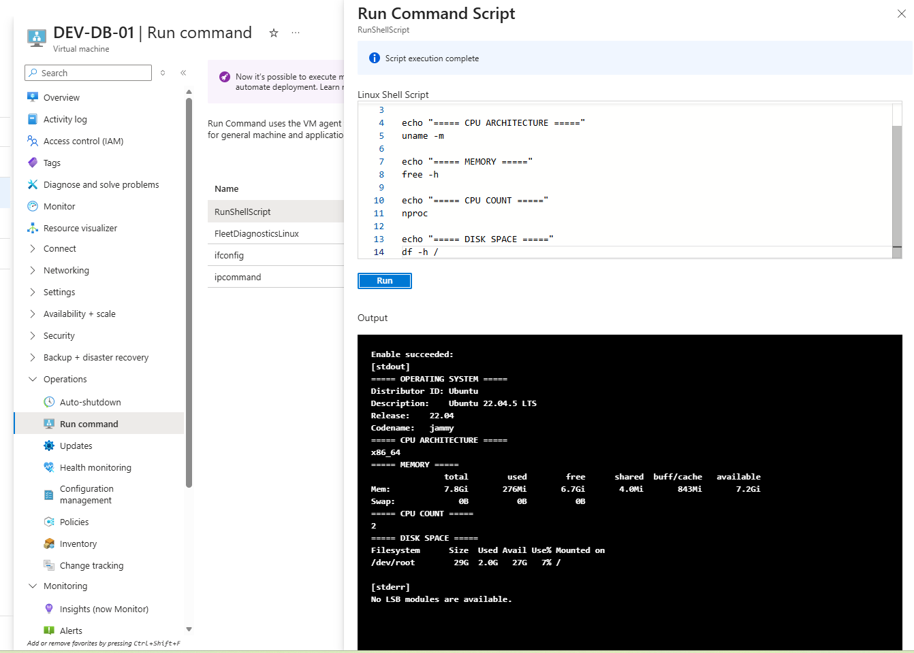

### 4.2 SQL Server repository configuration

The Microsoft signing key and SQL Server 2022 repository were configured on Ubuntu.

Repository configuration:

```bash
curl -fsSL https://packages.microsoft.com/keys/microsoft.asc \
  | sudo tee /etc/apt/trusted.gpg.d/microsoft.asc

curl -fsSL https://packages.microsoft.com/config/ubuntu/22.04/mssql-server-2022.list \
  | sudo tee /etc/apt/sources.list.d/mssql-server-2022.list
```

The repository was refreshed using:

```bash
sudo apt-get update
```

The SQL Server package was installed using:

```bash
sudo DEBIAN_FRONTEND=noninteractive apt-get install -y mssql-server
```

The installed package version was verified as:

`16.0.4325.4-2`

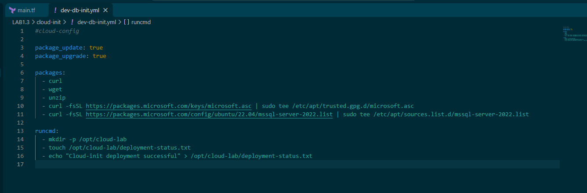

### 4.3 Azure Key Vault

| Setting | Configuration |
|---|---|
| Key Vault name | `kv-cloudeng-dev-01` |
| Resource group | `RG-CloudEng-01` |
| Region | South Africa North |
| Authorization model | Azure RBAC |
| Soft delete | Enabled |
| Soft-delete retention | 7 days |
| Purge protection | Enabled |
| Secret name | `sql-sa-password` |

The SQL Server administrator password was stored as a Key Vault secret.

The actual secret value is intentionally excluded from this document and from the evidence repository.

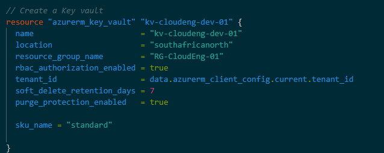

### 4.4 Managed identity

The virtual machine was configured with a system-assigned managed identity.

Identity details observed through Azure CLI:

| Property | Value |
|---|---|
| VM | `DEV-DB-01` |
| Identity type | `SystemAssigned` |
| Principal ID | `<principal-id>` |
| Tenant ID | `<tenant-id>` |

The identity allowed the VM to request Azure access tokens through the Azure Instance Metadata Service (IMDS).

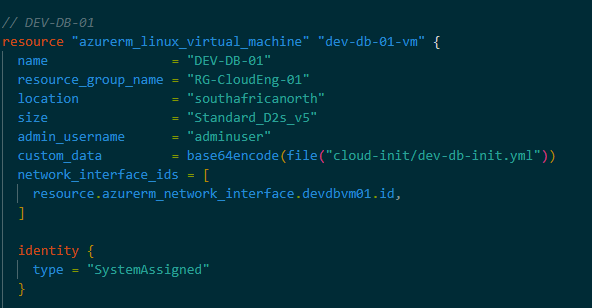

### 4.5 Key Vault RBAC assignment

The VM's managed identity was granted the **Key Vault Secrets User** role at the Key Vault resource scope.

Terraform resource:

```hcl
resource "azurerm_role_assignment" "kv-user" {
  scope                = azurerm_key_vault.kv-cloudeng-dev-01.id
  role_definition_name = "Key Vault Secrets User"
  principal_id         = azurerm_linux_virtual_machine.dev-db-01-vm.identity[0].principal_id
  principal_type       = "ServicePrincipal"
}
```

The assignment used a Terraform resource reference to the VM identity rather than hardcoding the principal ID.

The role assignment was subsequently checked using Azure CLI.

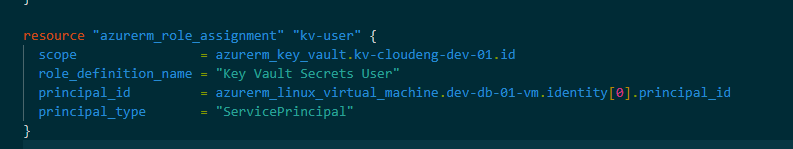

### 4.6 SQL Server configuration

| Setting | Configuration |
|---|---|
| Product | Microsoft SQL Server 2022 |
| Edition | Developer Edition |
| Version | `16.0.4325.4` |
| Operating system | Ubuntu 22.04.5 LTS |
| SQL command-line tools | SQLCMD |
| SQLCMD version | `18.7.0001.1` |
| Configured memory limit | 4096 MB |

The SQL Server memory configuration file showed:

```ini
[memory]
memorylimitmb = 4096
```

The configuration was followed by a SQL Server service restart.

---

## 5. Implementation Activities

### 5.1 Configured the SQL Server package repository

The Microsoft signing key and SQL Server 2022 Ubuntu repository were configured.

The package repository was inspected to confirm that SQL Server packages were available.

Package availability was checked using:

```bash
apt-cache policy mssql-server
```

The package version was subsequently installed and verified.

### 5.2 Installed SQL Server 2022

The package installation was performed through Azure VM Run Command.

The installation command was:

```bash
sudo DEBIAN_FRONTEND=noninteractive apt-get install -y mssql-server
```

Package installation was verified using:

```bash
dpkg-query -W -f='${Status} ${Version}\n' mssql-server
```

Observed result:

```text
install ok installed 16.0.4325.4-2
```

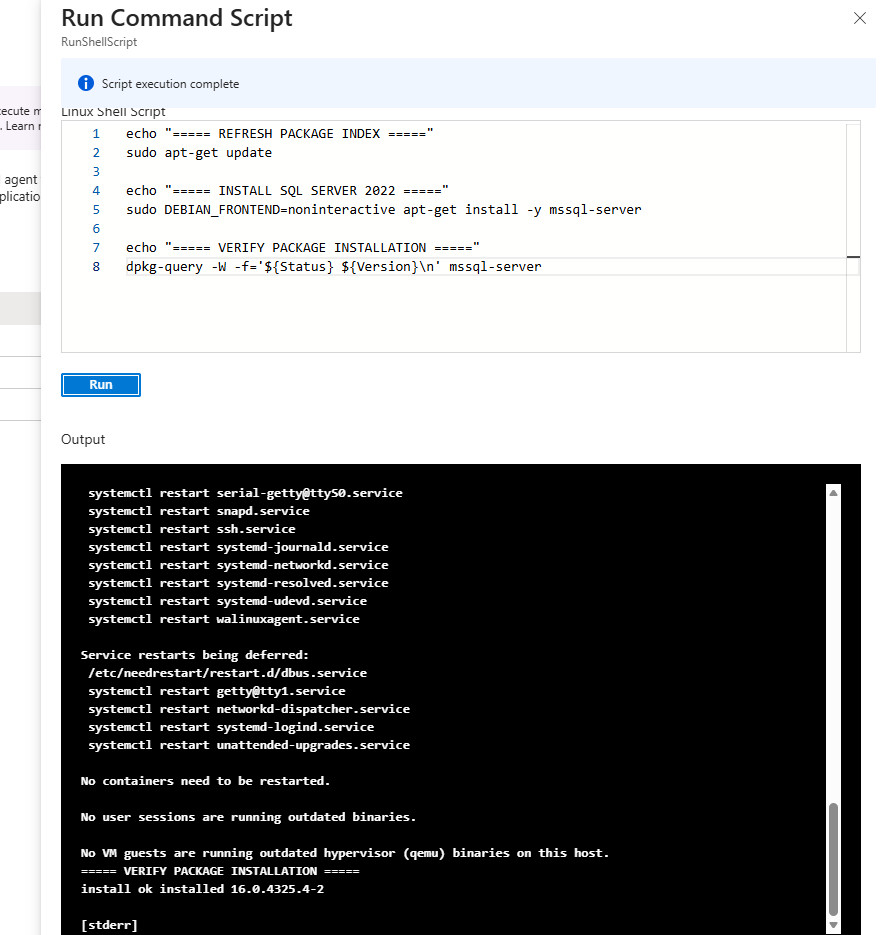

At this stage, the SQL Server package was installed, but initial SQL Server configuration had not yet been completed.

### 5.3 Enabled and inspected the managed identity

The system-assigned identity was inspected through Azure CLI.

```powershell
az vm identity show `
  --resource-group RG-CloudEng-01 `
  --name DEV-DB-01 `
  --output json
```

The output confirmed the identity type and principal ID.

### 5.4 Configured Key Vault RBAC through Terraform

A Terraform role assignment was added to grant the VM identity access to retrieve secrets from the Key Vault.

The assigned role was:

`Key Vault Secrets User`

The assignment used:

- Key Vault resource ID as the scope.
- VM system-assigned identity principal ID.
- `ServicePrincipal` as the principal type.

Azure CLI was used to inspect the role assignment.

The resulting output confirmed the Key Vault Secrets User role and the VM principal ID at the Key Vault scope.

### 5.5 Investigated the initial Key Vault authorization failure

An initial attempt to create an object named `sql-sa-password` resulted in a `Forbidden` error.

The error indicated that the requested operation was not permitted by the Key Vault RBAC configuration.

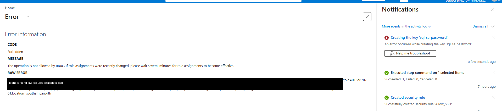

The investigation identified an important distinction: the initial operation was attempting to create a **Key**, whereas the SQL Server administrator password needed to be stored as a **Secret**.

The correct Key Vault object type was selected under:

`Objects → Secrets`

The secret was then created successfully.

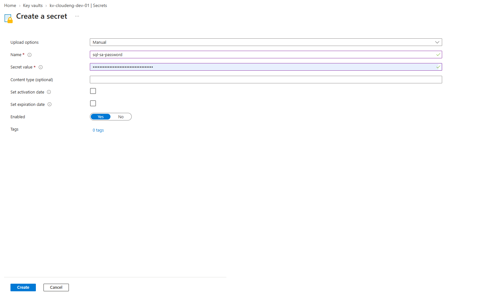

This troubleshooting step reinforced the distinction between Key Vault keys and secrets, as well as the importance of matching the required RBAC permissions to the intended operation.

### 5.6 Installed and verified jq

The Linux VM required `jq` to parse JSON responses from the Azure metadata and Key Vault APIs.

The utility was installed using:

```bash
sudo apt-get install -y jq
```

The installation was verified using:

```bash
jq --version
```

Observed version:

```text
jq-1.6
```

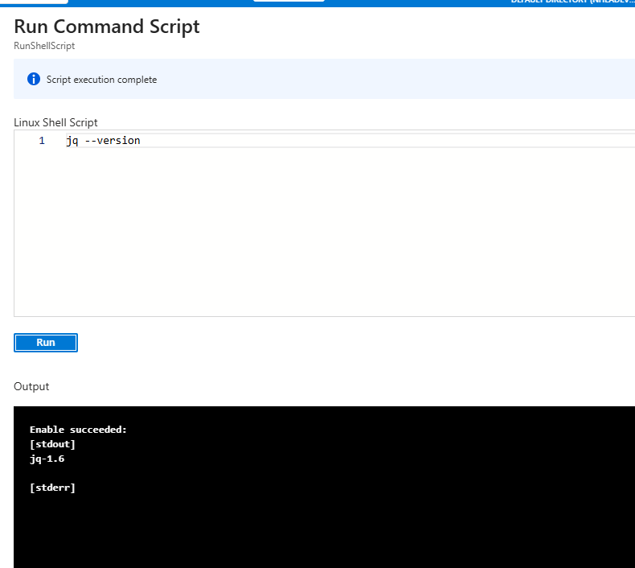

### 5.7 Retrieved the Key Vault secret using managed identity

The VM used the Azure Instance Metadata Service to request an access token for Azure Key Vault.

The metadata endpoint used was:

```text
http://169.254.169.254/metadata/identity/oauth2/token
```

The request used the Key Vault resource audience and the required API version.

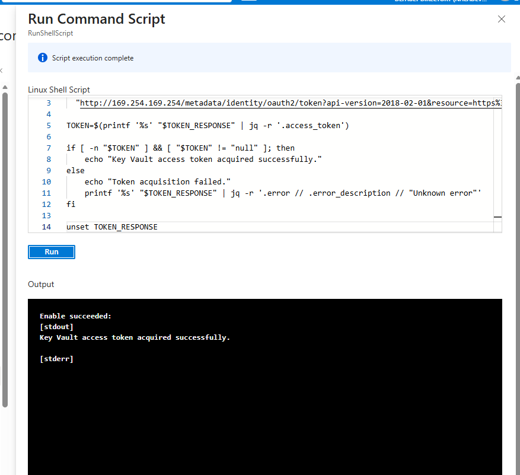

The returned JSON response was parsed using `jq`.

The resulting access token was used to authenticate to the Key Vault REST API and retrieve the `sql-sa-password` secret.

The successful Run Command output confirmed:

```text
Managed identity token acquired.
SUCCESS: Key Vault secret retrieved.
```

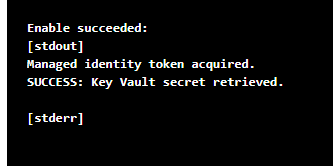

The script was designed not to print the actual password.

This demonstrated that the VM could authenticate to Key Vault and retrieve the secret without embedding the password in the deployment script.

### 5.8 Attempted interactive SQL Server setup

The initial setup attempt used:

```bash
sudo /opt/mssql/bin/mssql-conf setup
```

SQL Server presented an interactive edition-selection prompt.

The available choices included Evaluation, Developer, Express, Web, Standard and Enterprise editions.

The interactive process was unsuitable for the Azure Run Command execution environment because the command required user input through a terminal.

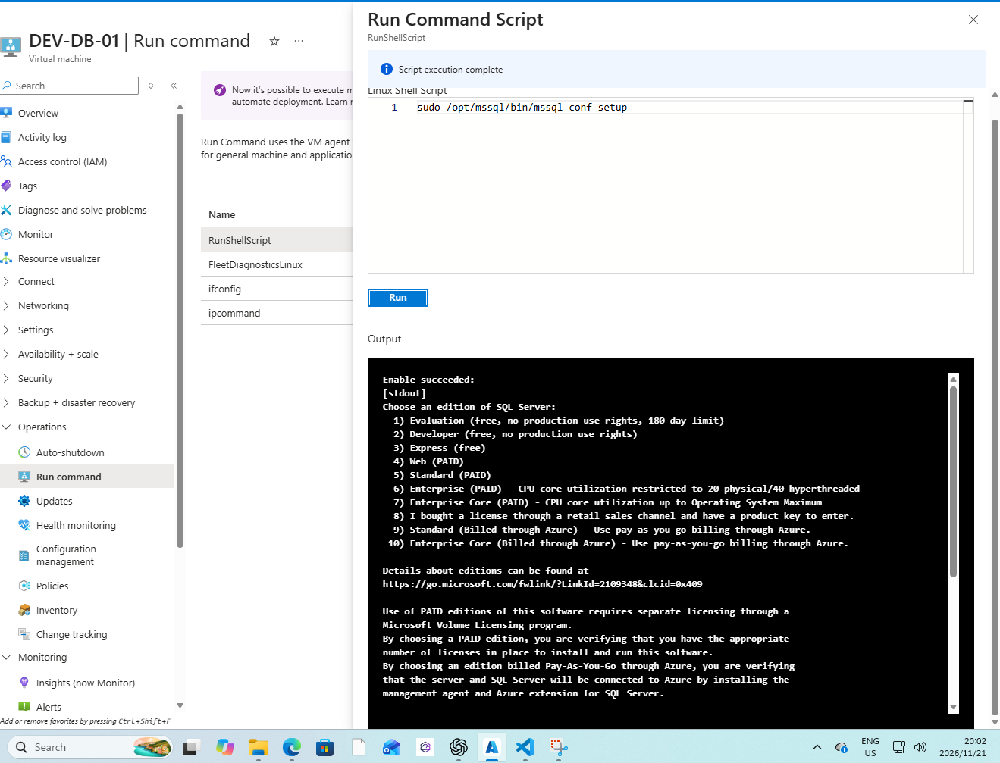

The setup approach was therefore changed to unattended configuration.

### 5.9 Completed unattended SQL Server configuration

The SQL Server setup was completed through an unattended script.

The script:

1. Acquired a managed identity token.
2. Retrieved the SQL administrator password from Key Vault.
3. Configured SQL Server Developer Edition.
4. Applied the SQL Server memory configuration.
5. Enabled the SQL Server systemd service.
6. Restarted the service.
7. Checked service status and enablement.

The setup output confirmed:

```text
Setup has completed successfully. SQL Server is now starting.
```

The subsequent service checks returned:

```text
active
enabled
```

This confirmed successful SQL Server initialization and service startup.

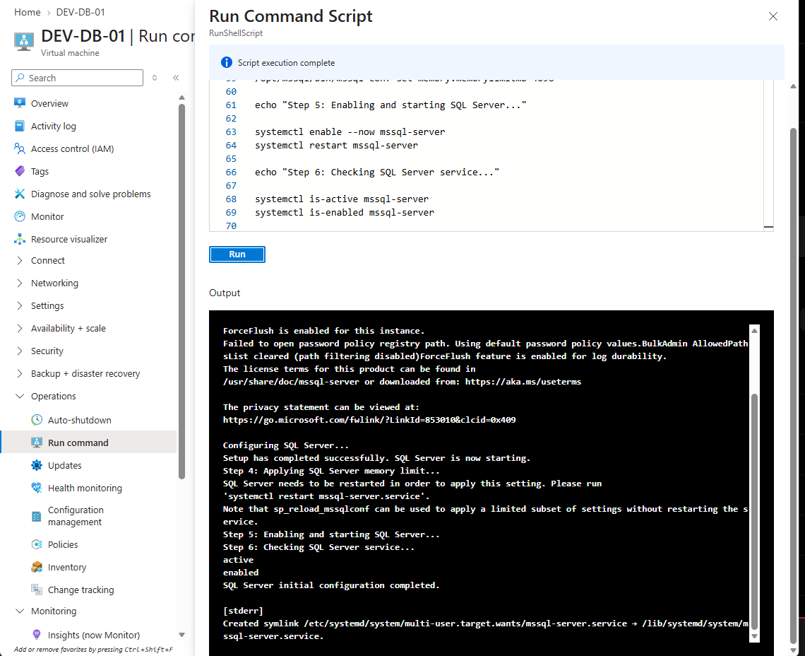

### 5.10 Configured SQL Server memory

The SQL Server configuration file showed:

```ini
[memory]
memorylimitmb = 4096
```

The configuration output indicated that a restart was required to apply the memory setting.

The service was restarted as part of the configuration process.

A later attempt to read the value through `mssql-conf get memory.memorylimitmb` returned:

```text
No setting for the given option found in '/var/opt/mssql/mssql.conf'.
```

Therefore, the configuration-file evidence confirms that the setting was written, but the attempted read-back command did not independently verify the value.

### 5.11 Investigated SQL Server command-line tools

The SQL Server command-line tools were required for connection testing.

An initial package installation attempt for `mssql-tools18` returned:

```text
E: Unable to locate package mssql-tools18
```

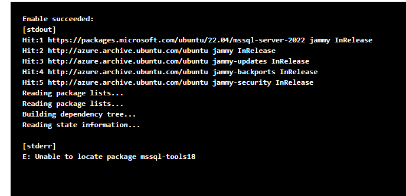

The package repository was inspected using:

```bash
apt-cache policy mssql-tools18
```

The repository subsequently showed an available candidate version.

SQLCMD was then available at:

```text
/opt/mssql-tools18/bin/sqlcmd
```

The installed tool version was verified as:

`18.7.0001.1`

### 5.12 Validated SQL Server connectivity

A SQLCMD connection test was executed against the local SQL Server instance.

The test retrieved the SQL Server version and connected login:

```sql
SELECT
    @@VERSION AS SQL_Server_Version,
    SYSTEM_USER AS Connected_Login;
```

The output confirmed:

- Microsoft SQL Server 2022.
- Version `16.0.4325.4`.
- Developer Edition.
- Ubuntu 22.04.5 LTS.
- Connected login `sa`.
- One row returned successfully.

This established that SQL Server was running and accepting a local authenticated SQL connection.

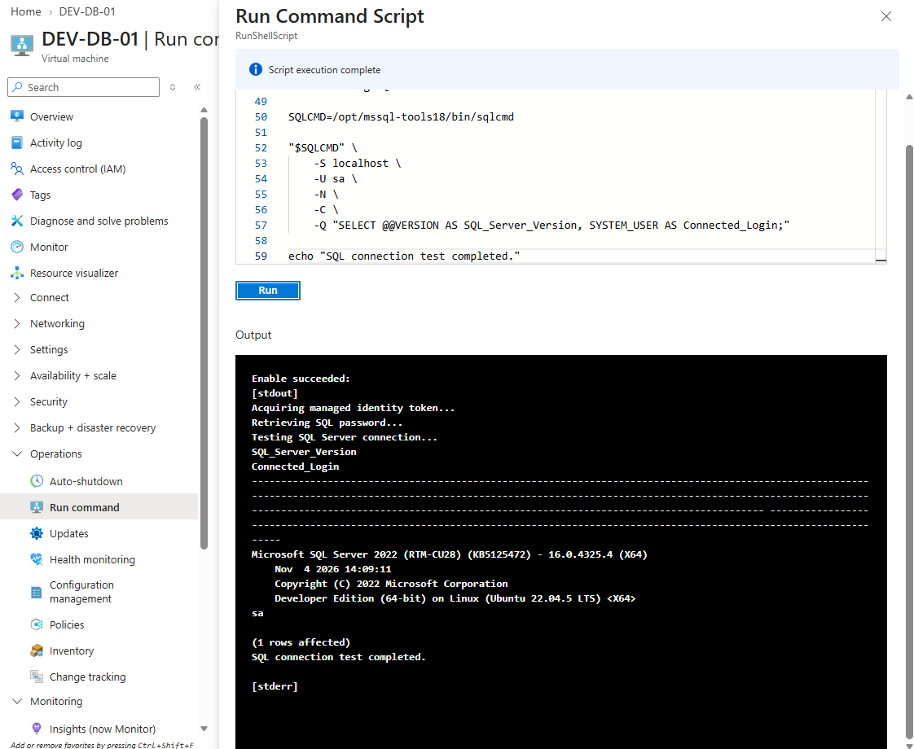

---

## 6. Validation and Results

| Validation item | Expected result | Result |
|---|---|---|
| System-assigned identity | Identity enabled on DEV-DB-01 | Confirmed |
| Identity principal ID | Principal ID returned by Azure CLI | Confirmed |
| Key Vault RBAC | Key Vault Secrets User assigned | Confirmed |
| Initial Key Vault authorization | Identify and resolve authorization failure | Completed |
| Secret creation | Password stored as a Key Vault secret | Confirmed |
| IMDS token acquisition | Key Vault access token acquired | Successful |
| Key Vault secret retrieval | Secret retrieved without displaying value | Successful |
| jq installation | JSON parser available | Confirmed — 1.6 |
| SQL Server package | Package installed | Confirmed — 16.0.4325.4-2 |
| SQL Server setup | Developer Edition initialized | Successful |
| SQL Server service | Service active | Confirmed |
| SQL Server service enablement | Service enabled | Confirmed |
| Memory configuration | Configuration file shows 4096 MB | Confirmed in file |
| Memory read-back | `mssql-conf get` returns configured value | Not confirmed |
| SQLCMD installation | Command-line client available | Confirmed — 18.7.0001.1 |
| SQL authentication | Local connection succeeds | Successful |
| SQL query execution | Version and login returned | Successful |

### Validation observations

The strongest validation was the successful SQLCMD query against the local SQL Server instance.

The query returned the SQL Server version and authenticated login, confirming that the database engine was initialized and accepting connections.

The implementation also demonstrated that managed identity could retrieve a Key Vault secret without requiring the secret to be hardcoded in the script.

**Validation limitation:** The supplied evidence confirms local SQL Server connectivity. It does not demonstrate remote SQL connectivity, application integration, database workload performance or production readiness.

---

## 7. Challenges and Lessons Learned

### 7.1 Key Vault object type and authorization

**Observed issue:**

An initial attempt to create the SQL password object resulted in a Forbidden error.

**Investigation:**

The operation was attempting to create a Key instead of a Secret.

**Resolution:**

The correct object type was selected under Key Vault Secrets, and the secret was created.

**Lesson learned:**

Azure Key Vault supports different object types with different operations. The intended object type and corresponding RBAC permissions must be considered when troubleshooting authorization errors.

### 7.2 Managed identity and Azure RBAC

**Observed requirement:**

The VM needed to access a secret without storing Azure application credentials.

**Resolution:**

A system-assigned identity was enabled and assigned the Key Vault Secrets User role at the vault scope.

**Lesson learned:**

Managed identities provide a practical way for Azure workloads to authenticate to supported services without embedding client secrets or application credentials.

### 7.3 Interactive setup through Azure Run Command

**Observed issue:**

The interactive `mssql-conf setup` command presented an edition-selection prompt.

**Resolution:**

An unattended setup approach was used to configure SQL Server through Azure Run Command.

**Lesson learned:**

Automation environments do not always provide an interactive terminal. Deployment scripts should be designed for non-interactive execution where possible.

### 7.4 SQL Server tools package availability

**Observed issue:**

The initial installation attempt could not locate `mssql-tools18`.

**Investigation:**

The package repository and available versions were inspected using `apt-cache`.

**Resolution:**

The tools package became available and SQLCMD was verified.

**Lesson learned:**

When a package cannot be located, inspect repository configuration and package availability before assuming the package does not exist.

### 7.5 Secure secret handling

**Implementation:**

The SQL administrator password was retrieved at runtime using managed identity and Key Vault.

**Lesson learned:**

Credentials should not be embedded in Terraform configuration, cloud-init YAML, scripts or publicly committed documentation. Secret values should not be printed in command output or screenshots.

---

## 8. Security Considerations and Outstanding Work

### Security controls implemented

- System-assigned managed identity enabled on the development VM.
- Azure RBAC used for Key Vault authorization.
- Key Vault Secrets User assigned to the VM identity.
- SQL administrator password stored as a Key Vault secret.
- Secret retrieved through an authenticated managed identity workflow.
- Password value excluded from documentation.
- SQL Server VM remains without a directly assigned public IP, based on the original VM deployment evidence.

### Security considerations

- The SQL Server `sa` account should be protected with a strong password and should not be used for routine application access.
- Future applications should use dedicated least-privilege database logins.
- SQL Server network access should remain restricted to explicitly approved sources.
- SQL Server port 1433 should not be exposed publicly.
- Secrets should be rotated when required.
- Key Vault access and secret retrieval should be monitored.
- SQL Server backups and recovery procedures should be implemented before production use.

### Outstanding work

The following activities were outside the completed scope of this implementation:

- Remote SQL connectivity validation.
- Application-to-database integration.
- Database creation and workload testing.
- Backup and restore validation.
- Production security hardening.
- Formal SQL Server memory read-back verification.
- Removal of temporary NAT Gateway and public IP resources when no longer needed, if they remain deployed.

---

## 9. Final Outcome

The development database VM was successfully integrated with Azure Key Vault using a system-assigned managed identity.

Azure RBAC was configured to allow the VM to retrieve the SQL Server administrator password securely.

The initial Key Vault authorization issue was investigated and resolved by using the correct Key Vault object type.

SQL Server 2022 Developer Edition was installed and configured on Ubuntu Server 22.04 through an unattended setup process.

The SQL Server service was enabled and confirmed active.

SQLCMD was installed, and a local authenticated connection successfully executed a query returning SQL Server version and login information.

This implementation established a working development database foundation and demonstrated practical use of Azure managed identity, Key Vault RBAC, Linux automation and SQL Server administration.

---

## 10. Related Documentation

| Document | Relationship |
|---|---|
| `README.md` — AZ-PRJ-001 Azure Environment Foundation | Project overview |
| `AZ-001-Network-Infrastructure.md` | Initial virtual network deployment |
| `AZ-002-Network-Security-Groups.md` | Network security controls |
| `AZ-003-Terraform-Based-Virtual-Machine-Provisioning.md` | Initial VM deployment |
| `AZ-004-Cloud-Init-and-Outbound-Connectivity.md` | Linux initialization and outbound connectivity |
| `LAB1.3/cloud-init/dev-db-init.yml` | Cloud-init configuration |
| `main.tf` | Terraform infrastructure configuration |

---

## 11. Evidence

Store approved, redacted evidence in the [AZ-005 images folder](../images/AZ-005/).

- [Target development database VM](../images/AZ-005/01_target_vm.png)
- [SQL Server repository configuration](../images/AZ-005/02_sql_repo_config.png)
- [Azure Key Vault configuration](../images/AZ-005/03_kv_config.png)
- [System-assigned managed identity](../images/AZ-005/04_mi_system_assigned.png)
- [Key Vault Secrets User RBAC assignment](../images/AZ-005/05_rbac_role_assignment.png)
- [SQL Server 2022 package installation](../images/AZ-005/06_installed_sql_2022.png)
- [Initial Key Vault authorization error](../images/AZ-005/07_kv_forbidden_error.png)
- [Key Vault secret creation](../images/AZ-005/08_create_secret.png)
- [jq version verification](../images/AZ-005/09_jq_parse.png)
- [Key Vault secret retrieval using managed identity](../images/AZ-005/10_retrieve_using_mi.png)
- [Key Vault access using the VM managed identity](../images/AZ-005/11_kv_mi.png)
- [Interactive SQL Server setup prompt](../images/AZ-005/12_conf_setup.png)
- [Unattended SQL Server setup and service verification](../images/AZ-005/12_sql_setup.png)
- [mssql-tools18 package lookup failure](../images/AZ-005/13_ms_sql_tool18_error.png)
- [Successful local SQL Server connection](../images/AZ-005/14_sql_connected.png)

---

**Implementation:** AZ-005 — SQL Server and Key Vault Integration

**Project:** AZ-PRJ-001 — Azure Environment Foundation

**Status:** Completed — SQL Server local connection validated
