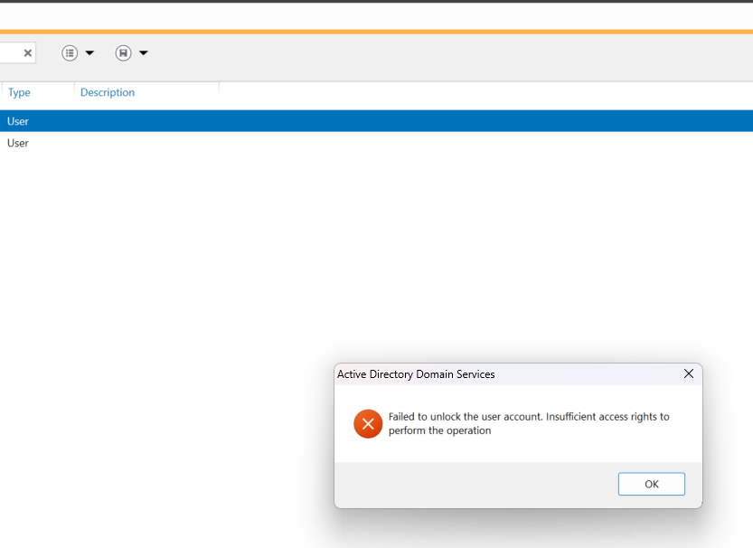
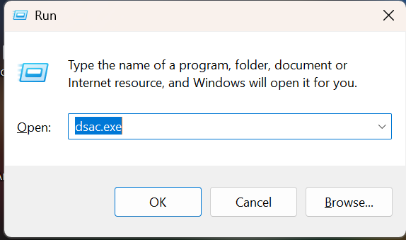

# AD-001: Troubleshooting and Unlocking a User Account in Microsoft Entra Domain Services

## 1. Case Information

| Field | Details |
|---|---|
| Case ID | AD-001 |
| Category | Active Directory |
| Subcategory | Authentication / User Management |
| Technology | Microsoft Entra ID, Microsoft Entra Domain Services |
| Tools | ADUC, ADAC, PowerShell, Microsoft Entra Admin Center |
| Scenario Type | Account Lockout / Password Reset |
| Audience | IT Support / System Administrators |
| Status | Documented |

---

## 2. Problem Description

A user is unable to log into their Windows workstation after multiple unsuccessful authentication attempts.

The account has become locked within Microsoft Entra Domain Services.

During troubleshooting, an administrator attempts to unlock the account but encounters insufficient access rights.

### Reported Symptoms

**User-side error:**

```text
The referenced account is currently locked out
and may not be logged into.
```

**Administrator-side error:**

```text
Failed to unlock the user account.
Insufficient access rights to perform the operation.
```

### Expected Outcome

- Identify why the account was locked.
- Establish whether the administrator has sufficient delegated permissions.
- Successfully unlock the affected account.
- Reset the password if necessary.
- Verify that the user can authenticate successfully.
- Identify potential causes of recurring account lockouts.

---

## 3. Technical Background

Microsoft Entra Domain Services provides managed domain services, including domain authentication, Group Policy and domain-joined computer management.

Account lockout policies protect the managed domain against repeated unsuccessful authentication attempts.

### Default Account Lockout Policy

| Setting | Default Value |
|---|---|
| Failed login attempts | 5 |
| Attempt counter reset period | 2 minutes |
| Account lockout duration | 30 minutes |

After five unsuccessful authentication attempts within the configured period, the account is locked for the configured duration.

The account automatically unlocks when the lockout duration expires.

These settings can be customised through Fine-Grained Password Policies (FGPP).

**Important distinction:**

An account locked within Microsoft Entra Domain Services is not necessarily the same as a locked Microsoft Entra ID account.

The two environments must be investigated separately.

---

## 4. Prerequisites and Permissions

Before attempting to unlock an account, ensure that the following requirements are met:

### Required Access

1. Access to the Microsoft Entra Admin Center.
2. Appropriate administrative permissions.
3. Access to a Windows management computer joined to the managed domain.
4. Active Directory Administrative Tools installed.
5. Membership in the appropriate delegated administrative group.

### Required Administrative Group

```text
AAD DC Administrators
```

This group provides delegated administrative permissions within Microsoft Entra Domain Services.

### Verify Group Membership

1. Open Microsoft Entra Admin Center.
2. Navigate to Identity → Groups → All Groups.
3. Search for `AAD DC Administrators`.
4. Open the group.
5. Select Members.
6. Confirm that the administrator account is listed.

If membership is required, an appropriately authorised administrator must add the account.

**Important:**

Having User Administrator permissions in Microsoft Entra ID does not automatically grant permission to manage membership of `AAD DC Administrators` or perform delegated operations within the managed domain.

After being added to the group:

- Allow membership synchronisation to complete.
- Sign out of Windows.
- Sign back in to obtain an updated security token.
- Reopen the Active Directory management console.

---

## 5. Investigation and Diagnosis

Before making changes, establish the nature of the problem.

### Initial Checks

| Check | Purpose |
|---|---|
| Confirm user identity | Ensure the correct account is being investigated. |
| Check account status | Establish whether the account is locked. |
| Verify administrator permissions | Identify possible delegated access issues. |
| Identify password authority | Determine where password changes must be performed. |
| Check previous authentication attempts | Identify potential causes of the lockout. |

### Understanding the Two Errors

**Error 1: Account Locked Out**

The user has exceeded the configured unsuccessful authentication threshold.

**Error 2: Insufficient Access Rights**

The administrator does not have the necessary delegated permissions to perform the unlock operation.

These are separate issues and should be investigated independently.



---

## 6. Resolution Procedure

### 6.1 Unlocking Through Active Directory Users and Computers (ADUC)

On a domain-joined management computer:

**Step 1: Open ADUC**

1. Press `Windows + R`.
2. Enter:

```powershell
dsa.exe
```

3. Press Enter.

If the command is unavailable, verify that the appropriate Remote Server Administration Tools (RSAT) are installed.

**Step 2: Locate the User**

1. Expand the managed domain.
2. Navigate to:

```text
AADDC Users
```

3. Locate the affected user.

Alternatively, use the search functionality.

**Step 3: Unlock the Account**

1. Right-click the affected user.
2. Select Properties.
3. Open the Account tab.
4. Locate the account unlock option.
5. Select:

```text
Unlock account
```

6. Select Apply.
7. Select OK.

The account should now be unlocked, provided the administrator has the necessary delegated permissions.

---

### 6.2 Resetting the User's Password

Unlocking an account and resetting its password are two separate operations.

A password reset may be necessary if the user has forgotten their password or continues experiencing authentication problems.

**Important: Identify the account's password source of authority before resetting it.**

| Account Type | Password Reset Location |
|---|---|
| Cloud-only Microsoft Entra account | Microsoft Entra Admin Center |
| Hybrid account synchronised from on-premises AD | Authoritative on-premises Active Directory |
| Hybrid account with password writeback configured | Microsoft Entra password reset may be supported |

#### Cloud-Only Account Password Reset

1. Open Microsoft Entra Admin Center.
2. Navigate to Identity → Users → All Users.
3. Search for the affected user.
4. Open the user account.
5. Select Reset Password.
6. Generate or enter a temporary password.
7. Communicate the temporary password securely.
8. Require the user to change it at the next sign-in, where supported.

For synchronised accounts, follow the configured source-of-authority and password synchronisation process.

A password reset in Microsoft Entra ID does not necessarily mean that the managed domain has immediately received the updated password hash.

Allow synchronisation to complete before repeated login attempts.

---

## 7. PowerShell Troubleshooting

The Active Directory PowerShell module provides an alternative method of investigating and unlocking accounts.

The following commands require the appropriate delegated permissions.

### Check Account Lockout Status

```powershell
Get-ADUser -Identity "username" -Properties LockedOut
```

### Unlock the Account

```powershell
Unlock-ADAccount -Identity "username"
```

### Verify Account Status

```powershell
Get-ADUser -Identity "username" -Properties LockedOut |
Select-Object Name, SamAccountName, LockedOut
```

### Expected Output

```text
Name           : User Name
SamAccountName : username
LockedOut      : False
```

A value of `False` indicates that the account is no longer locked.

---

## 8. Investigating Repeated Account Lockouts

If the account becomes locked again after being unlocked, investigate the source of the repeated authentication failures.

Repeatedly unlocking an account without identifying the cause does not resolve the underlying problem.

### Common Causes

| Potential Cause | Investigation |
|---|---|
| Incorrect password | Confirm that the user is entering the correct credentials. |
| Windows Credential Manager | Check for outdated saved credentials. |
| Outlook | Investigate applications using an old password. |
| Mapped network drives | Check stored authentication credentials. |
| VPN clients | Investigate saved credentials. |
| Remote Desktop | Check existing sessions and saved credentials. |
| Mobile devices | Identify applications attempting authentication with an old password. |
| Background services | Check services running under the affected account. |

### Investigating Account Lockout Events

Microsoft Entra Domain Services supports security auditing.

When auditing is enabled, investigate account lockout events using:

```text
Event ID: 4740
Description: A user account was locked out.
```

These events can assist in identifying the source of repeated lockouts.

### Azure Monitor / Log Analytics Query

```kusto
AADDomainServicesAccountManagement
| where TimeGenerated >= ago(7d)
| where OperationName has "4740"
| sort by TimeGenerated desc
```

**Note:** Audit records are only available from the time auditing is enabled. Verify that the relevant diagnostic settings and log categories are configured.

---

## 9. Post-Resolution Verification

After unlocking the account and resetting the password where necessary, perform the following checks.

| Verification | Expected Result |
|---|---|
| Account lockout status | Account is no longer locked. |
| Password authentication | User can authenticate successfully. |
| Windows login | User can access their workstation. |
| Desktop access | User profile loads successfully. |
| Microsoft 365 access | Required applications remain accessible. |
| Account status | Account does not become locked again. |

### Final Verification

Ask the affected user to:

1. Attempt Windows authentication.
2. Confirm access to their desktop.
3. Test Outlook and other required applications.
4. Report any additional authentication errors.

Monitor the account if repeated lockouts were previously reported.

---

## 10. Common Administrative Errors

| Error | Possible Cause | Recommended Action |
|---|---|---|
| Insufficient access rights | Missing delegated permissions | Verify AAD DC Administrators membership and permissions. |
| Account remains locked | Lockout has not expired or unlock was unsuccessful | Recheck account status. |
| Password reset unsuccessful | Incorrect password authority or insufficient permissions | Verify account source of authority. |
| User still cannot log in | Password hash synchronisation delay | Allow synchronisation and retry. |
| Account locks repeatedly | Another device or application is using an old password | Investigate authentication attempts. |

---

## 11. Security Considerations

- Do not grant Global Administrator privileges simply to resolve an account lockout.
- Use appropriate delegated administrative permissions.
- Never share temporary passwords through unsecured communication channels.
- Investigate recurring lockouts instead of repeatedly unlocking accounts.
- Do not modify account lockout policies without approval.
- Record administrative actions for auditing purposes.
- Follow the organisation's access management procedures.

---

## 12. Lessons Learned

This scenario highlights several important identity administration concepts.

1. Microsoft Entra ID and Microsoft Entra Domain Services provide different identity management capabilities.
2. Account lockout and password reset are separate administrative operations.
3. Administrative roles in Microsoft Entra ID do not automatically grant delegated permissions within the managed domain.
4. Group membership and security token refresh are important when permissions are updated.
5. Password synchronisation must be considered when troubleshooting hybrid identity environments.
6. Repeated account lockouts require root-cause investigation.
7. PowerShell provides an effective alternative for account administration and verification.

---

## 13. References and Further Reading

- Microsoft documentation: Troubleshoot account lockout in Microsoft Entra Domain Services.
- Microsoft documentation: Password and account lockout policies in Microsoft Entra Domain Services.
- Microsoft documentation: Microsoft Entra Domain Services administration concepts.
- Microsoft documentation: Microsoft Entra password reset.

---

## 14. Case Closure

| Field | Details |
|---|---|
| Case ID | AD-001 |
| Resolution Status | Documented |
| Primary Technology | Microsoft Entra Domain Services |
| Related Technologies | Microsoft Entra ID, ADUC, PowerShell |
| Primary Issue | User account lockout |
| Secondary Issue | Insufficient delegated permissions |
| Resolution | Account unlock and password verification |
| Documentation Category | Active Directory / Authentication |

**End of Knowledge Base Article**