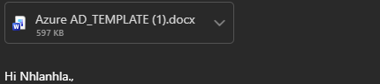
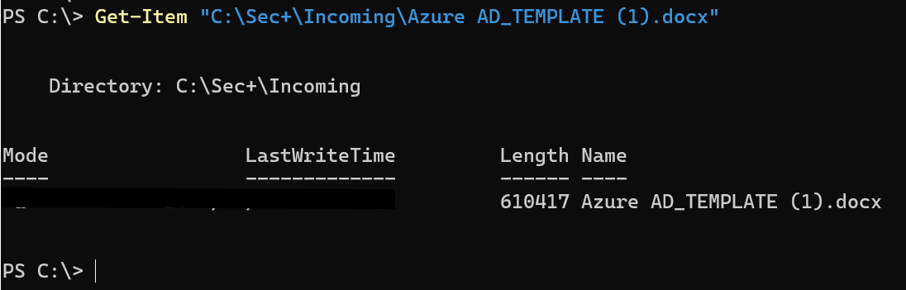
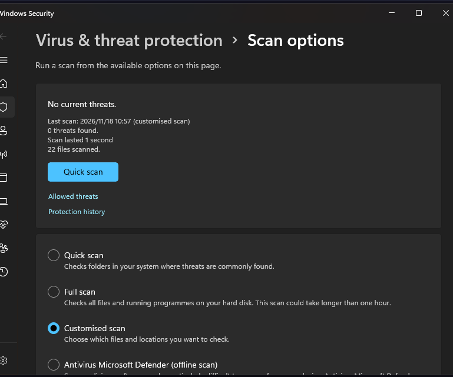
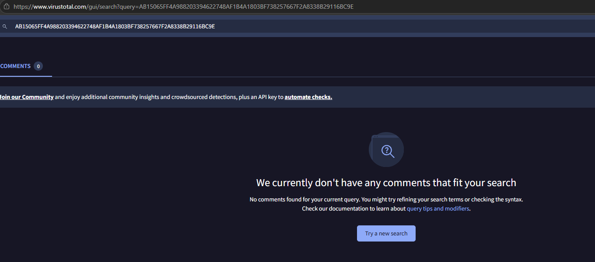
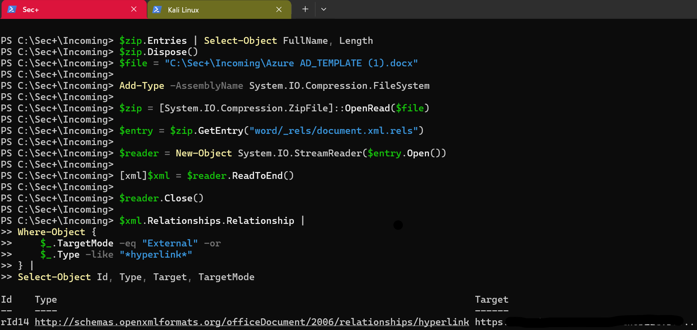
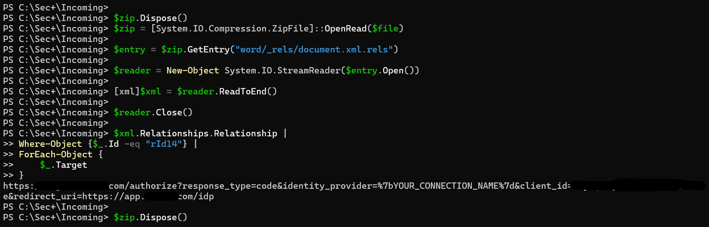

# SEC-001 – Safe Handling and Initial Security Assessment of External Office Documents

**Category:** Cybersecurity / Endpoint Security  
**Case ID:** SEC-001  
**Investigation Type:** External File Security Assessment  
**Platform:** Windows 11  
**Status:** Preliminary Assessment Completed  
**Risk Classification:** Low Apparent Risk – Subject to Final Validation

---

## 1. Overview

This document establishes a practical procedure for handling and investigating Microsoft Office documents received from external organisations.

External Office documents may contain malicious macros, embedded objects, suspicious hyperlinks, external references or instructions designed to compromise corporate systems.

The objective is to perform an initial security assessment before allowing an externally received document to interact with the corporate environment.

This case documents an actual investigation involving an externally supplied Microsoft Word document intended for Microsoft Entra ID (formerly Azure Active Directory) SSO configuration.

## 2. Investigation Scenario

An external document was received through Microsoft Outlook Desktop from the 3rd party team.

The document was titled:

`Azure AD_TEMPLATE (1).docx`



The document contained:
- Text explaining the proposed SSO configuration.
- Images illustrating the proposed setup.
- A hyperlink directing users to a 3rd party authentication endpoint.

Before opening the document, an initial security investigation was conducted.

The investigation focused on identifying potentially malicious content, validating the document's origin and examining its authentication hyperlink.

## 3. Investigation Environment

| Component | Details |
|---|---|
| Operating System | Windows 11 |
| Email Client | Microsoft Outlook Desktop |
| Antivirus | Microsoft Defender Antivirus |
| Investigation Tools | PowerShell |
| File Reputation | VirusTotal |
| File Format | DOCX |
| Investigation Directory | C:\Sec+\Incoming\ |

### Investigation Tools

- Microsoft Defender Antivirus
- Windows PowerShell
- VirusTotal
- Windows File Explorer

## 4. Initial Security Precautions

Before investigating the attachment, the following precautions were followed:

1. The document was not opened in Microsoft Word.
2. Macros and active content were not enabled.
3. Embedded hyperlinks were not clicked.
4. The attachment was downloaded without opening it.
5. The file was placed in a dedicated investigation directory.
6. The document was treated as untrusted until the initial checks were completed.

These precautions reduce the risk of accidentally executing malicious content.

## 5. File Identification and Metadata

The document was downloaded from Outlook and stored in:

`C:\Sec+\Incoming\`

PowerShell was used to identify the file and retrieve its metadata.

Command:

```powershell
Get-Item "C:\Sec+\Incoming\Azure AD_TEMPLATE (1).docx"
```


### Observed Results

| Attribute | Result |
|---|---|
| Filename | Azure AD_TEMPLATE (1).docx |
| Extension | .docx |
| File Size | 610,417 bytes |
| Format | Microsoft Word Open XML |

The `.docx` format is based on the Office Open XML standard.

Unlike older macro-enabled Word formats, standard `.docx` files do not support embedded VBA macro projects in the normal way. However, they can still contain potentially dangerous links, embedded objects and other content.

## 6. Microsoft Defender Antivirus Scan

A customised scan was performed using Windows Security.

### Navigation

Windows Security → Virus & threat protection → Scan options → Customised scan.

The investigation directory was selected for scanning.



### Results

| Attribute | Result |
|---|---|
| Scan Type | Customised Scan |
| Files Scanned | 22 |
| Threats Found | 0 |
| Scan Status | No Current Threats |

**Assessment:**

Microsoft Defender did not identify any threats during the scan.

A clean antivirus result does not guarantee that a document is completely safe. Additional investigation is required.

## 7. SHA256 Hash Generation

A SHA256 hash was generated to establish a unique fingerprint for the document.

Command:

```powershell
$file = "C:\Sec+\Incoming\Azure AD_TEMPLATE (1).docx"

Get-FileHash $file -Algorithm SHA256
```

### Generated Hash

```text
AB15065FF4A988203394622748AF1B4A1803BF738257667F2A8338B29116BC9E
```

### Purpose

The SHA256 fingerprint can be used to:

- Search threat intelligence databases.
- Identify previously reported malicious files.
- Compare file integrity.
- Identify whether the same file has been investigated previously.

The hash was subsequently searched using VirusTotal.

## 8. VirusTotal Reputation Check

The SHA256 fingerprint was submitted as a search query on VirusTotal.

The initial investigation reached the Comments section, which returned no matching comments.

**Important:** The absence of comments does not establish that the document is clean.

The Detection tab must be reviewed to establish whether VirusTotal has an existing analysis report and whether any security engines have flagged the file.

No definitive VirusTotal verdict was recorded during this investigation.



## 9. DOCX Internal Structure Inspection

A DOCX file is essentially a ZIP-based package containing XML documents, relationships, images and potentially embedded objects.

PowerShell was used to inspect the internal archive without opening the document in Microsoft Word.

### Command

```powershell
Add-Type -AssemblyName System.IO.Compression.FileSystem

$file = "C:\Sec+\Incoming\Azure AD_TEMPLATE (1).docx"

$zip = [System.IO.Compression.ZipFile]::OpenRead($file)

$zip.Entries | Select-Object FullName, Length

$zip.Dispose()
```

### Components of Interest

| Component | Investigation Purpose |
|---|---|
| word/document.xml | Main document content |
| word/_rels/ | Document relationships |
| word/embeddings/ | Embedded objects |
| word/activeX/ | ActiveX components |
| word/vbaProject.bin | VBA macro project |
| word/media/ | Embedded images |

The document was found to contain text, configuration images and a hyperlink.

The presence of these components is not inherently malicious.

A complete archive and relationship review should be retained when performing future investigations.

## 10. Hyperlink Extraction

The document contained an embedded hyperlink.

Rather than clicking the hyperlink, its destination was extracted directly from the DOCX relationship file.

The relationship file is located at:

`word/_rels/document.xml.rels`

### PowerShell Command

```powershell
$zip = [System.IO.Compression.ZipFile]::OpenRead($file)

$entry = $zip.GetEntry("word/_rels/document.xml.rels")

$reader = New-Object System.IO.StreamReader($entry.Open())

[xml]$xml = $reader.ReadToEnd()

$reader.Close()

$xml.Relationships.Relationship |
Where-Object {
    $_.TargetMode -eq "External" -or
    $_.Type -like "*hyperlink*"
} |
Select-Object Id, Type, Target, TargetMode

$zip.Dispose()
```

### Extracted Relationship



| Attribute | Result |
|---|---|
| Relationship ID | rId14 |
| Relationship Type | Hyperlink |
| Destination | https://login.3rd-party.example/authorize |
| Protocol | HTTPS |

The complete extracted URL contained additional authentication parameters.

## 11. Authentication URL Analysis

The extracted hyperlink contained the following parameters:



| Parameter | Value / Purpose |
|---|---|
| response_type | code |
| identity_provider | {YOUR_CONNECTION_NAME} |
| client_id | Application identifier |
| redirect_uri | https://app.3rd-party.example/idp |

### Observations

**11.1 Authentication Endpoint**

The URL uses:

`https://login.3rd-party.example/authorize`

The endpoint structure is consistent with an OAuth 2.0 authorisation request.

**11.2 Response Type**

The parameter:

`response_type=code`

indicates an authorisation-code request.

**11.3 Identity Provider**

The parameter:

`identity_provider={YOUR_CONNECTION_NAME}`

contains a placeholder rather than a populated connection name.

This suggests that the URL is intended to be customised during the SSO configuration process.

**11.4 Client Identifier**

The URL contains a client identifier used to identify the application initiating the authentication request.

**11.5 Redirect URI**

The URL contains:

`https://app.3rd-party.example/idp`

This is the specified authentication response destination.

The redirect URI must be independently validated against the application's official SSO documentation and configuration.

### Security Considerations

The URL structure is consistent with an OAuth authorisation request.

However, the presence of HTTPS and familiar OAuth parameters does not independently establish that an authentication endpoint is safe.

The authentication flow, application registration and redirect URI must still be validated.

## 12. Sender Verification

The document was received through Microsoft Outlook Desktop.

The sender was confirmed by the user as the official 3rd Party team.

The destination domain and redirect URI were consistent with the document's stated purpose of configuring 3rd Party SSO.

This provides additional confidence in the document's legitimacy.

However, sender display names and email addresses alone are not sufficient proof of authenticity. Email headers, sender authentication and independent vendor confirmation should be considered where necessary.

## 13. Security Assessment

### Investigation Summary

| Security Check | Result | Status |
|---|---|---|
| File Extension | DOCX | Completed |
| File Metadata | Retrieved | Completed |
| Microsoft Defender | 0 threats detected | Passed |
| SHA256 Generation | Successfully generated | Completed |
| VirusTotal | Comments checked; detection verdict outstanding | Incomplete |
| DOCX Structure | Initial inspection performed | Partial |
| Hyperlink Extraction | Successful | Completed |
| URL Analysis | OAuth parameters identified | Completed |
| Sender Verification | Official 3rd Party team confirmed by user | Completed |
| Configuration Validation | Not yet performed | Pending |

### Preliminary Conclusion

The initial investigation did not identify a confirmed malicious indicator.

The document's contents, authentication endpoint and sender information were consistent with the stated purpose of configuring 3rd Party SSO.

However, the investigation did not establish that every component of the document was harmless.

**Final Classification: Low Apparent Risk – Preliminary Assessment.**

The document may proceed to controlled review in Microsoft Word Protected View, subject to organisational security procedures.

External content should remain disabled, and the proposed SSO configuration must be independently validated before implementation.

## 14. Recommendations

Before implementing the proposed configuration:

1. Review the complete document in Protected View.
2. Verify the SSO configuration against official 3rd Party documentation.
3. Validate the application registration and client identifier.
4. Confirm the redirect URI.
5. Review requested permissions and authentication scopes.
6. Ensure that administrative privileges are granted only where necessary.
7. Test the integration in a controlled environment before production deployment.

## 15. Lessons Learned

This investigation demonstrates the importance of performing security checks before opening externally received Office documents.

Key lessons:

- Never automatically trust external email attachments.
- Antivirus scanning should be one part of a wider investigation.
- SHA256 hashes provide useful file identification.
- DOCX files can be inspected through their internal XML structure.
- Embedded hyperlinks should be extracted and investigated without clicking them.
- OAuth authentication links must be evaluated beyond simply checking whether they use HTTPS.
- A legitimate document can still contain unsafe configuration instructions.

## 16. References

- Microsoft Defender Antivirus
- Microsoft Office Open XML documentation
- Microsoft Office Protected View
- VirusTotal
- 3rd Party Support Centre

---

**Document Owner:** Nhlanhla 
**Knowledge Base Reference:** SEC-001  
**Category:** Endpoint Security