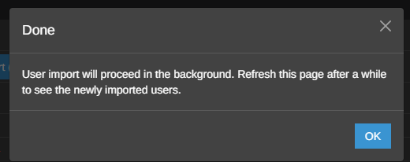
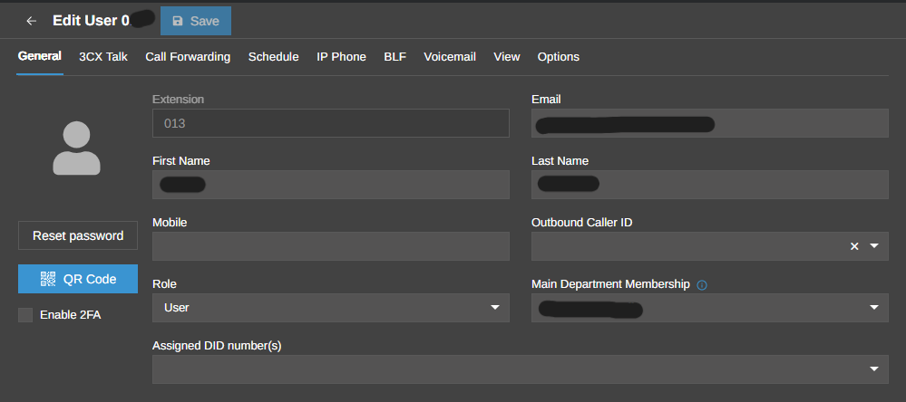
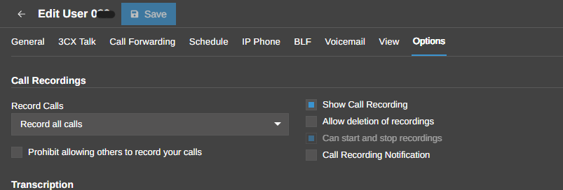

# 3CX-001 – Creating a 3CX User Through CSV Import

## 1. Overview

This document explains how to create a new user in 3CX V20 using CSV import.

CSV import provides an alternative to manually creating users through the 3CX Management Console. It simplifies user provisioning, reduces repetitive administrative tasks and provides a consistent approach to onboarding employees.

This procedure was successfully tested using a single-user CSV import.

## 2. Environment

| Component | Details |
|---|---|
| Platform | 3CX |
| Version | V20 |
| Edition | PRO |
| Feature | CSV User Import |
| Environment | Production |
| Case Reference | 3CX-001 |
| Status | Successfully Implemented |

## 3. Prerequisites

Before proceeding, ensure that:

- You have administrative access to the 3CX Management Console.
- The required extension number is available.
- User information has been verified.
- The CSV file follows the supported 3CX import structure.
- The appropriate department and user role have been identified.

## 4. User Information

The following user was used during implementation:

| Field | Value |
|---|---|
| Extension | 000 |
| First Name | Name |
| Last Name | Surname |
| Email Address | Name.Surname@company.co.za |
| Department | User Staff |
| Role | User |

## 5. CSV Preparation

Prepare the CSV file using the documented 3CX bulk-import template.

The CSV must contain the appropriate column headers and corresponding user information.

**Important considerations:**

- Use the correct 3CX field names.
- Ensure the extension number is available.
- Validate email addresses.
- Ensure department and role values are correct.
- Save the completed file in `.csv` format.

The CSV template used for this implementation is maintained separately.

## 6. Implementation Procedure

### Step 1 – Access the 3CX Management Console

Log into the 3CX Management Console using an account with the required administrative permissions.

### Step 2 – Navigate to User Import

Navigate to:

`Admin → Users → Import`

### Step 3 – Select the CSV File

Select the prepared CSV file containing the user information.

Review the selected file before proceeding.

### Step 4 – Import the User

Initiate the import process and allow 3CX to process the CSV file.

Once completed, navigate back to the Users section.

### Step 5 – Verify User Creation

Locate extension **000** and verify that the following information has been populated correctly:

- First Name: Name
- Last Name: Surname
- Email: Name.Surname@company.co.za
- Department: User Staff
- Role: User

### Step 6 – Enable Call Recording

Open the newly created extension.

Navigate to:

`Options → Call Recordings → Record all calls`

Verify that the recording option is enabled.

**Note:** Recording configuration must be checked separately after importing the user. Do not assume that successful CSV import automatically enables recording.

## 7. Verification

Following the import, perform the following checks:

| Test | Expected Result | Status |
|---|---|---|
| CSV import | Import completes successfully | Passed |
| User creation | User appears in 3CX | Passed |
| Extension assignment | Extension 000 assigned | Passed |
| User details | Details populated correctly | Verify |
| Department assignment | User Staff | Verify |
| User role | User | Verify |
| Call recording | Record all calls enabled | Verify |

## 8. Troubleshooting

| Issue | Possible Cause | Recommended Action |
|---|---|---|
| CSV import unsuccessful | Incorrect CSV structure | Review column headers and formatting |
| User not created | Invalid or incomplete information | Validate CSV entries |
| Extension conflict | Extension already assigned | Check available extensions |
| Incorrect user details | Incorrect CSV values | Correct the source CSV |
| Call recording disabled | Recording configuration not enabled | Review extension recording options |

## 9. Security and Operational Considerations

- Only authorised administrators should perform user imports.
- Verify employee information before importing.
- Protect CSV files containing employee information.
- Ensure recording policies comply with applicable organisational and legal requirements.
- Confirm recording settings before handing over an extension.

## 10. Outcome

The CSV-based user provisioning process was successfully implemented.

Extension 000 was successfully created for user using the CSV import functionality.

This confirms that the process can be used as an alternative to manually creating individual users through the 3CX Management Console.

The procedure can be reused for future employee onboarding.

## 11. References

- 3CX V20 Management Console.
- 3CX User Import functionality.
- Internal 3CX CSV User Import Template.

---

**Case ID:** 3CX-001  
**Category:** User Administration  
**Implementation Status:** Successful